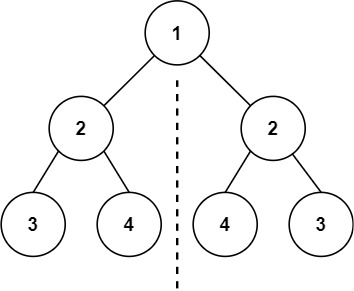
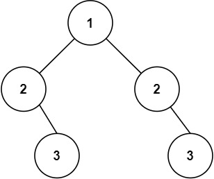

# 101. Symmetric Tree - LeetCode Python/Java/C++/JS/C#/Go/Ruby Solutions

> [**Build Your Programmer Brand at coder.id →**](https://www.coder.id)

Visit original link: [101. Symmetric Tree - LeetCode Python/Java/C++/JS/C#/Go/Ruby Solutions](https://www.coder.id/leetcode/en/solutions/101-symmetric-tree) for a better experience!

LeetCode link: [101. Symmetric Tree](https://leetcode.com/problems/symmetric-tree), difficulty: **Easy**.

## LeetCode description of "101. Symmetric Tree"

Given the `root` of a binary tree, *check whether it is a mirror of itself* (i.e., symmetric around its center).

**Follow up:** Could you solve it both recursively and iteratively?

### [Example 1]



**Input**: `root = [1,2,2,3,4,4,3]`

**Output**: `true`

### [Example 2]



**Input**: `root = [1,2,2,null,3,null,3]`

**Output**: `false`

### [Constraints]

- The number of nodes in the tree is in the range `[1, 1000]`.
- `-100 <= Node.val <= 100`

## Intuition


## Complexity

- Time complexity: `O(n)`.
- Space complexity: `O(n)`.

## Python

```python
# Definition for a binary tree node.
# class TreeNode:
#     def __init__(self, val=0, left=None, right=None):
#         self.val = val
#         self.left = left
#         self.right = right

class Solution:
    def isSymmetric(self, root: TreeNode | None) -> bool:
        return is_symmetric(root.left, root.right)

def is_symmetric(node1, node2):
    if node1 is None or node2 is None:
        return node1 is None and node2 is None

    if node1.val != node2.val:
        return False

    return is_symmetric(node1.left, node2.right) and is_symmetric(node1.right, node2.left)
```

## Other languages

```java
// Welcome to create a PR to complete the code of this language, thanks!
```

> 🚀 **Level Up Your Developer Identity**
>
> While mastering algorithms is key, showcasing your talent is what gets you hired.
>
> We recommend [**coder.id**](https://www.coder.id) — the ultimate all-in-one personal branding platform for programmers.
>
> **The All-In-One Career Powerhouse:**
> - 📄 **Resume, Portfolio & Blog:** Integrate your skills, GitHub projects, and writing into one stunning site.
> - 🌐 **Free Custom Domain:** Bind your own personal domain for free—forever.
> - ✨ **Premium Subdomains:** Stand out with elite tech handle like `name.coder.id`.
>
> [**Build Your Programmer Brand at coder.id →**](https://www.coder.id)

---

Visit original link: [101. Symmetric Tree - LeetCode Python/Java/C++/JS/C#/Go/Ruby Solutions](https://www.coder.id/leetcode/en/solutions/101-symmetric-tree) for a better experience!

GitHub repository: [leetcode-python-java](https://github.com/leetcode-python-java/leetcode-python-java).

