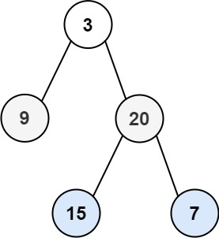

# 102. Binary Tree Level Order Traversal - LeetCode Python/Java/C++/JS/C#/Go/Ruby Solutions

> [**Build Your Programmer Brand at coder.id →**](https://www.coder.id)

Visit original link: [102. Binary Tree Level Order Traversal - LeetCode Python/Java/C++/JS/C#/Go/Ruby Solutions](https://www.coder.id/leetcode/en/solutions/102-binary-tree-level-order-traversal) for a better experience!

LeetCode link: [102. Binary Tree Level Order Traversal](https://leetcode.com/problems/binary-tree-level-order-traversal), difficulty: **Medium**.

## LeetCode description of "102. Binary Tree Level Order Traversal"

Given the `root` of a binary tree, return *the level order traversal of its nodes' values*. (i.e., from left to right, level by level).

### [Example 1]



**Input**: `root = [3,9,20,null,null,15,7]`

**Output**: `[[3],[9,20],[15,7]]`

### [Example 2]

**Input**: `root = [1]`

**Output**: `[[1]]`

### [Example 3]

**Input**: `root = []`

**Output**: `[]`

### [Constraints]

- The number of nodes in the tree is in the range `[0, 2000]`.
- `-1000 <= Node.val <= 1000`

### [Hints]

<details>
  <summary>Hint 1</summary>
  Use a queue to perform BFS.

  
</details>

## Intuition


## Complexity

- Time complexity: `O(n)`.
- Space complexity: `O(n)`.

## Python

```python
# Definition for a binary tree node.
# class TreeNode:
#     def __init__(self, val=0, left=None, right=None):
#         self.val = val
#         self.left = left
#         self.right = right


class Solution:
    def levelOrder(self, root: TreeNode | None) -> list[list[int]]:
        if root is None:
            return []

        results = []
        queue = deque([root]) # key 1. Breadth First Search need a queue.

        while queue:
            size = len(queue)
            result = []
            
            for _ in range(size): # key 2: Go through all nodes (previous level) in queue.
                node = queue.popleft()
                result.append(node.val)

                if node.left:
                    queue.append(node.left)
                if node.right:
                    queue.append(node.right)
            
            results.append(result.copy())
        
        return results
```

## Other languages

```java
// Welcome to create a PR to complete the code of this language, thanks!
```

> 🚀 **Level Up Your Developer Identity**
>
> While mastering algorithms is key, showcasing your talent is what gets you hired.
>
> We recommend [**coder.id**](https://www.coder.id) — the ultimate all-in-one personal branding platform for programmers.
>
> **The All-In-One Career Powerhouse:**
> - 📄 **Resume, Portfolio & Blog:** Integrate your skills, GitHub projects, and writing into one stunning site.
> - 🌐 **Free Custom Domain:** Bind your own personal domain for free—forever.
> - ✨ **Premium Subdomains:** Stand out with elite tech handle like `name.coder.id`.
>
> [**Build Your Programmer Brand at coder.id →**](https://www.coder.id)

---

Visit original link: [102. Binary Tree Level Order Traversal - LeetCode Python/Java/C++/JS/C#/Go/Ruby Solutions](https://www.coder.id/leetcode/en/solutions/102-binary-tree-level-order-traversal) for a better experience!

GitHub repository: [leetcode-python-java](https://github.com/leetcode-python-java/leetcode-python-java).

