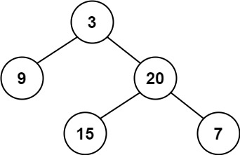
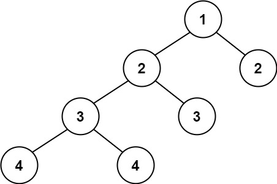

# 110. Balanced Binary Tree - LeetCode Python/Java/C++/JS/C#/Go/Ruby Solutions

> [**Build Your Programmer Brand at coder.id →**](https://www.coder.id)

Visit original link: [110. Balanced Binary Tree - LeetCode Python/Java/C++/JS/C#/Go/Ruby Solutions](https://www.coder.id/leetcode/en/solutions/110-balanced-binary-tree) for a better experience!

LeetCode link: [110. Balanced Binary Tree](https://leetcode.com/problems/balanced-binary-tree), difficulty: **Easy**.

## LeetCode description of "110. Balanced Binary Tree"

Given a binary tree, determine if it is **height-balanced**.

### [Example 1]



**Input**: `root = [3,9,20,null,null,15,7]`

**Output**: `true`

### [Example 2]



**Input**: `root = [1,2,2,3,3,null,null,4,4]`

**Output**: `false`

### [Example 3]

**Input**: `root = []`

**Output**: `true`

### [Constraints]

- The number of nodes in the tree is in the range `[0, 5000]`.
- `-10^4 <= Node.val <= 10^4`

## Intuition


## Complexity

- Time complexity: `O(log n)`.
- Space complexity: `O(log n)`.

## Python

```python
# Definition for a binary tree node.
# class TreeNode:
#     def __init__(self, val=0, left=None, right=None):
#         self.val = val
#         self.left = left
#         self.right = right

class Solution:
    def isBalanced(self, root: TreeNode | None) -> bool:
        if root is None:
            return True

        return abs(get_depth(root.left) - get_depth(root.right)) <= 1


def get_depth(node):
    if node is None:
        return 0
    
    return max(get_depth(node.left), get_depth(node.right)) + 1
```

## Other languages

```java
// Welcome to create a PR to complete the code of this language, thanks!
```

> 🚀 **Level Up Your Developer Identity**
>
> While mastering algorithms is key, showcasing your talent is what gets you hired.
>
> We recommend [**coder.id**](https://www.coder.id) — the ultimate all-in-one personal branding platform for programmers.
>
> **The All-In-One Career Powerhouse:**
> - 📄 **Resume, Portfolio & Blog:** Integrate your skills, GitHub projects, and writing into one stunning site.
> - 🌐 **Free Custom Domain:** Bind your own personal domain for free—forever.
> - ✨ **Premium Subdomains:** Stand out with elite tech handle like `name.coder.id`.
>
> [**Build Your Programmer Brand at coder.id →**](https://www.coder.id)

---

Visit original link: [110. Balanced Binary Tree - LeetCode Python/Java/C++/JS/C#/Go/Ruby Solutions](https://www.coder.id/leetcode/en/solutions/110-balanced-binary-tree) for a better experience!

GitHub repository: [leetcode-python-java](https://github.com/leetcode-python-java/leetcode-python-java).

