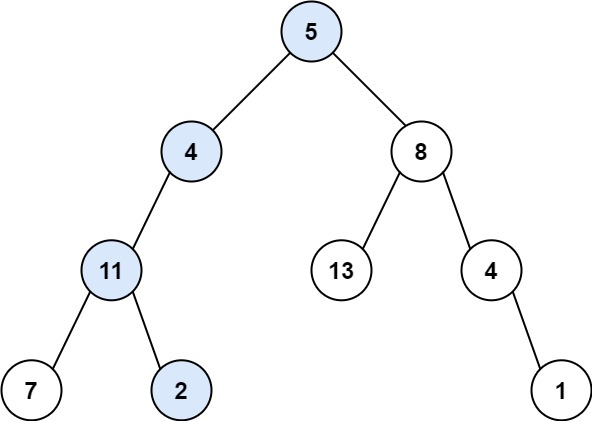
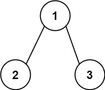

# 112. Path Sum - LeetCode Python/Java/C++/JS/C#/Go/Ruby Solutions

> [**Build Your Programmer Brand at coder.id →**](https://www.coder.id)

Visit original link: [112. Path Sum - LeetCode Python/Java/C++/JS/C#/Go/Ruby Solutions](https://www.coder.id/leetcode/en/solutions/112-path-sum) for a better experience!

LeetCode link: [112. Path Sum](https://leetcode.com/problems/path-sum), difficulty: **Easy**.

## LeetCode description of "112. Path Sum"

Given the `root` of a binary tree and an integer `targetSum`, return `true` if the tree has a **root-to-leaf** path such that adding up all the values along the path equals `targetSum`.

A **leaf** is a node with no children.

### [Example 1]



**Input**: `root = [5,4,8,11,null,13,4,7,2,null,null,null,1], targetSum = 22`

**Output**: `true`

**Explanation**: 

<p>The root-to-leaf path with the target sum is shown.</p>


### [Example 2]



**Input**: `root = [1,2,3], targetSum = 5`

**Output**: `false`

**Explanation**: 

<div class="highlight"><pre class="highlight plaintext"><code>There are two root-to-leaf paths in the tree:
(1 --&gt; 2): The sum is 3.
(1 --&gt; 3): The sum is 4.
There is no root-to-leaf path with sum = 5.
</code></pre></div>

### [Example 3]

**Input**: `root = [], targetSum = 0`

**Output**: `false`

**Explanation**: 

<p>Since the tree is empty, there are no root-to-leaf paths.</p>


### [Constraints]

- The number of nodes in the tree is in the range `[0, 5000]`.
- `-1000 <= Node.val <= 1000`
- `-1000 <= targetSum <= 1000`

## Intuition 1


## Complexity

- Time complexity: `O(n)`.
- Space complexity: `O(n)`.

## Python

```python
# Definition for a binary tree node.
# class TreeNode:
#     def __init__(self, val=0, left=None, right=None):
#         self.val = val
#         self.left = left
#         self.right = right

class Solution:
    def hasPathSum(self, root: TreeNode | None, targetSum: int) -> bool:
        if root is None:
            return False

        self.target_sum = targetSum
        self.result = False
        self.sum_ = root.val
        self.traverse(root)
        return self.result

    def traverse(self, node):
        if self.result:
            return

        if is_leaf(node) and self.sum_ == self.target_sum:
            self.result = True
            return
        
        if node.left:
            self.sum_ += node.left.val
            self.traverse(node.left)
            self.sum_ -= node.left.val # Rollback

        if node.right:
            self.sum_ += node.right.val
            self.traverse(node.right)
            self.sum_ -= node.right.val # Rollback


def is_leaf(node):
    return node and node.left is None and node.right is None
```

## Other languages

```java
// Welcome to create a PR to complete the code of this language, thanks!
```

## Intuition 2


## Complexity

- Time complexity: `O(n)`.
- Space complexity: `O(n)`.

## Python

```python
# Definition for a binary tree node.
# class TreeNode:
#     def __init__(self, val=0, left=None, right=None):
#         self.val = val
#         self.left = left
#         self.right = right

class Solution:
    def hasPathSum(self, root: TreeNode | None, targetSum: int) -> bool:
        if root is None:
            return False

        self.target_sum = targetSum
        self.result = False
        self.traverse(root, root.val)
        return self.result

    def traverse(self, node, sum_):
        if self.result:
            return

        if is_leaf(node) and sum_ == self.target_sum:
            self.result = True
            return

        if node.left:
            self.traverse(node.left, sum_ + node.left.val)

        if node.right:
            self.traverse(node.right, sum_ + node.right.val)


def is_leaf(node):
    return node and node.left is None and node.right is None
```

## Other languages

```java
// Welcome to create a PR to complete the code of this language, thanks!
```

> 🚀 **Level Up Your Developer Identity**
>
> While mastering algorithms is key, showcasing your talent is what gets you hired.
>
> We recommend [**coder.id**](https://www.coder.id) — the ultimate all-in-one personal branding platform for programmers.
>
> **The All-In-One Career Powerhouse:**
> - 📄 **Resume, Portfolio & Blog:** Integrate your skills, GitHub projects, and writing into one stunning site.
> - 🌐 **Free Custom Domain:** Bind your own personal domain for free—forever.
> - ✨ **Premium Subdomains:** Stand out with elite tech handle like `name.coder.id`.
>
> [**Build Your Programmer Brand at coder.id →**](https://www.coder.id)

---

Visit original link: [112. Path Sum - LeetCode Python/Java/C++/JS/C#/Go/Ruby Solutions](https://www.coder.id/leetcode/en/solutions/112-path-sum) for a better experience!

GitHub repository: [leetcode-python-java](https://github.com/leetcode-python-java/leetcode-python-java).

