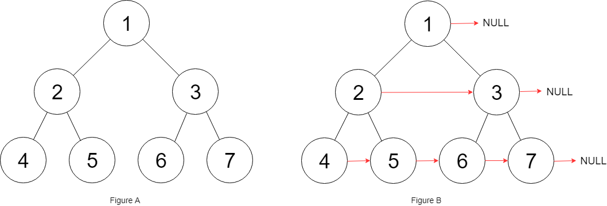

# 116. Populating Next Right Pointers in Each Node - LeetCode Python/Java/C++/JS/C#/Go/Ruby Solutions

> [**Build Your Programmer Brand at coder.id →**](https://www.coder.id)

Visit original link: [116. Populating Next Right Pointers in Each Node - LeetCode Python/Java/C++/JS/C#/Go/Ruby Solutions](https://www.coder.id/leetcode/en/solutions/116-populating-next-right-pointers-in-each-node) for a better experience!

LeetCode link: [116. Populating Next Right Pointers in Each Node](https://leetcode.com/problems/populating-next-right-pointers-in-each-node), difficulty: **Medium**.

## LeetCode description of "116. Populating Next Right Pointers in Each Node"

You are given a **perfect binary tree** where all leaves are on the same level, and every parent has two children. The binary tree has the following definition:

```
struct Node {
  int val;
  Node *left;
  Node *right;
  Node *next;
}
```

Populate each next pointer to point to its next right node. If there is no next right node, the next pointer should be set to `NULL`.

Initially, all next pointers are set to `NULL`.

**Follow-up:**

- You may only use constant extra space.
- The recursive approach is fine. You may assume implicit stack space does not count as extra space for this problem.

### [Example 1]



**Input**: `root = [1,2,3,4,5,6,7]`

**Output**: `[1,#,2,3,#,4,5,6,7,#]`

**Explanation**: 

<p>Given the above perfect binary tree (Figure A), your function should populate each next pointer to point to its next right node, just like in Figure B. The serialized output is in level order as connected by the next pointers, with &#39;#&#39; signifying the end of each level.</p>


### [Example 2]

**Input**: `root = []`

**Output**: `[]`

### [Example 3]


**Input**: `root = [1,2,3,4,5,6,7]`

**Output**: `[1,#,2,3,#,4,5,6,7,#]`

**Explanation**: 

<p>Given the above perfect binary tree (Figure A), your function should populate each next pointer to point to its next right node, just like in Figure B. The serialized output is in level order as connected by the next pointers, with &#39;#&#39; signifying the end of each level.</p>


### [Example 4]

**Input**: `root = []`

**Output**: `[]`

### [Constraints]

- The number of nodes in the tree is in the range `[0, 2^12 - 1]`.
- `-1000 <= Node.val <= 1000`

## Intuition


## Complexity

- Time complexity: `O(n)`.
- Space complexity: `O(n)`.

## Python

```python
"""
# Definition for a Node.
class Node:
    def __init__(self, val: int = 0, left: 'Node' = None, right: 'Node' = None, next: 'Node' = None):
        self.val = val
        self.left = left
        self.right = right
        self.next = next
"""

class Solution:
    def connect(self, root: 'Optional[Node]') -> 'Optional[Node]':
        if root is None:
            return

        queue = deque([root]) # key 1. Breadth First Search need a queue.

        while queue:
            size = len(queue)
            prev = None
            
            for _ in range(size): # key 2: Go through all nodes (previous level) in queue.
                node = queue.popleft()

                if prev:
                    prev.next = node # key 3

                prev = node # key 4

                if node.left:
                    queue.append(node.left)

                if node.right:
                    queue.append(node.right)
        
        return root
```

## Other languages

```java
// Welcome to create a PR to complete the code of this language, thanks!
```

> 🚀 **Level Up Your Developer Identity**
>
> While mastering algorithms is key, showcasing your talent is what gets you hired.
>
> We recommend [**coder.id**](https://www.coder.id) — the ultimate all-in-one personal branding platform for programmers.
>
> **The All-In-One Career Powerhouse:**
> - 📄 **Resume, Portfolio & Blog:** Integrate your skills, GitHub projects, and writing into one stunning site.
> - 🌐 **Free Custom Domain:** Bind your own personal domain for free—forever.
> - ✨ **Premium Subdomains:** Stand out with elite tech handle like `name.coder.id`.
>
> [**Build Your Programmer Brand at coder.id →**](https://www.coder.id)

---

Visit original link: [116. Populating Next Right Pointers in Each Node - LeetCode Python/Java/C++/JS/C#/Go/Ruby Solutions](https://www.coder.id/leetcode/en/solutions/116-populating-next-right-pointers-in-each-node) for a better experience!

GitHub repository: [leetcode-python-java](https://github.com/leetcode-python-java/leetcode-python-java).

