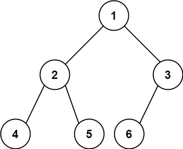

# 222. Count Complete Tree Nodes - LeetCode Python/Java/C++/JS/C#/Go/Ruby Solutions

> [**Build Your Programmer Brand at coder.id →**](https://www.coder.id)

Visit original link: [222. Count Complete Tree Nodes - LeetCode Python/Java/C++/JS/C#/Go/Ruby Solutions](https://www.coder.id/leetcode/en/solutions/222-count-complete-tree-nodes) for a better experience!

LeetCode link: [222. Count Complete Tree Nodes](https://leetcode.com/problems/count-complete-tree-nodes), difficulty: **Medium**.

## LeetCode description of "222. Count Complete Tree Nodes"

Given the `root` of a **complete** binary tree, return the number of the nodes in the tree.

According to **[Wikipedia](http://en.wikipedia.org/wiki/Binary_tree#Types_of_binary_trees)**, every level, except possibly the last, is completely filled in a complete binary tree, and all nodes in the last level are as far left as possible. It can have between `1` and `2^h` nodes inclusive at the last level `h`.

Design an algorithm that runs in less than `O(n)` time complexity.

### [Example 1]



**Input**: `root = [1,2,3,4,5,6]`

**Output**: `6`

### [Example 2]

**Input**: `root = []`

**Output**: `0`

### [Example 3]

**Input**: `root = [1]`

**Output**: `1`

### [Constraints]

- The number of nodes in the tree is in the range `[0, 5 * 10^4]`.
- `0 <= Node.val <= 5 * 10^4`
- The tree is guaranteed to be **complete**.

## Intuition


## Complexity

- Time complexity: `O(log n)`.
- Space complexity: `O(log n)`.

## Python

```python
# Definition for a binary tree node.
# class TreeNode:
#     def __init__(self, val=0, left=None, right=None):
#         self.val = val
#         self.left = left
#         self.right = right

class Solution:
    def countNodes(self, root: Optional[TreeNode]) -> int:
        if root is None:
            return 0
        
        # calc depth_left
        node = root
        depth_left = 1
        while node.left:
            depth_left += 1
            node = node.left
        
        # calc depth_right
        node = root
        depth_right = 1
        while node.right:
            depth_right += 1
            node = node.right

        if depth_left == depth_right: # It is a full binary tree.
            return 2 ** depth_left - 1 # key

        return self.countNodes(root.left) + self.countNodes(root.right) + 1
```

## Other languages

```java
// Welcome to create a PR to complete the code of this language, thanks!
```

> 🚀 **Level Up Your Developer Identity**
>
> While mastering algorithms is key, showcasing your talent is what gets you hired.
>
> We recommend [**coder.id**](https://www.coder.id) — the ultimate all-in-one personal branding platform for programmers.
>
> **The All-In-One Career Powerhouse:**
> - 📄 **Resume, Portfolio & Blog:** Integrate your skills, GitHub projects, and writing into one stunning site.
> - 🌐 **Free Custom Domain:** Bind your own personal domain for free—forever.
> - ✨ **Premium Subdomains:** Stand out with elite tech handle like `name.coder.id`.
>
> [**Build Your Programmer Brand at coder.id →**](https://www.coder.id)

---

Visit original link: [222. Count Complete Tree Nodes - LeetCode Python/Java/C++/JS/C#/Go/Ruby Solutions](https://www.coder.id/leetcode/en/solutions/222-count-complete-tree-nodes) for a better experience!

GitHub repository: [leetcode-python-java](https://github.com/leetcode-python-java/leetcode-python-java).

