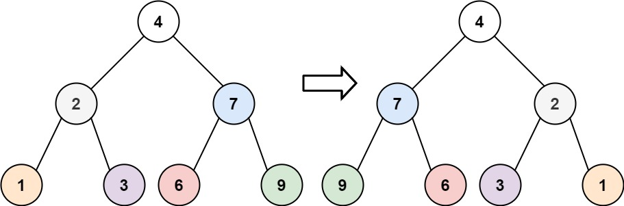
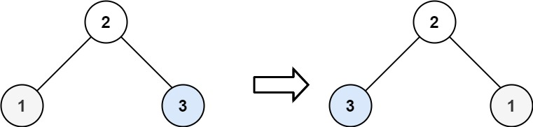

# 226. Invert Binary Tree - LeetCode Python/Java/C++/JS/C#/Go/Ruby Solutions

> [**Build Your Programmer Brand at coder.id →**](https://www.coder.id)

Visit original link: [226. Invert Binary Tree - LeetCode Python/Java/C++/JS/C#/Go/Ruby Solutions](https://www.coder.id/leetcode/en/solutions/226-invert-binary-tree) for a better experience!

LeetCode link: [226. Invert Binary Tree](https://leetcode.com/problems/invert-binary-tree), difficulty: **Easy**.

## LeetCode description of "226. Invert Binary Tree"

Given the `root` of a binary tree, invert the tree, and return *its root*.

### [Example 1]



**Input**: `root = [4,2,7,1,3,6,9]`

**Output**: `[4,7,2,9,6,3,1]`

### [Example 2]



**Input**: `root = [2,1,3]`

**Output**: `[2,3,1]`

### [Example 3]

**Input**: `root = []`

**Output**: `[]`

### [Constraints]

- The number of nodes in the tree is in the range `[0, 100]`.
- `-100 <= Node.val <= 100`

## Intuition


## Complexity

- Time complexity: `O(n)`.
- Space complexity: `O(n)`.

## Python

```python
# Definition for a binary tree node.
# class TreeNode:
#     def __init__(self, val=0, left=None, right=None):
#         self.val = val
#         self.left = left
#         self.right = right

class Solution:
    def invertTree(self, root: Optional[TreeNode]) -> Optional[TreeNode]:
        node = root
        if node is None:
            return
        if node.left is None and node.right is None:
            return node
        
        # node.left, node.right = node.right, node.left # This is a quicker way in Python to swap.

        left = node.left
        node.left = node.right
        node.right = left

        self.invertTree(node.left)
        self.invertTree(node.right)

        return node
```

## Other languages

```java
// Welcome to create a PR to complete the code of this language, thanks!
```

> 🚀 **Level Up Your Developer Identity**
>
> While mastering algorithms is key, showcasing your talent is what gets you hired.
>
> We recommend [**coder.id**](https://www.coder.id) — the ultimate all-in-one personal branding platform for programmers.
>
> **The All-In-One Career Powerhouse:**
> - 📄 **Resume, Portfolio & Blog:** Integrate your skills, GitHub projects, and writing into one stunning site.
> - 🌐 **Free Custom Domain:** Bind your own personal domain for free—forever.
> - ✨ **Premium Subdomains:** Stand out with elite tech handle like `name.coder.id`.
>
> [**Build Your Programmer Brand at coder.id →**](https://www.coder.id)

---

Visit original link: [226. Invert Binary Tree - LeetCode Python/Java/C++/JS/C#/Go/Ruby Solutions](https://www.coder.id/leetcode/en/solutions/226-invert-binary-tree) for a better experience!

GitHub repository: [leetcode-python-java](https://github.com/leetcode-python-java/leetcode-python-java).

