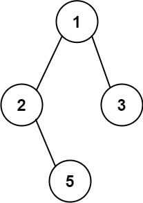

# 257. Binary Tree Paths - LeetCode Python/Java/C++/JS/C#/Go/Ruby Solutions

> [**Build Your Programmer Brand at coder.id →**](https://www.coder.id)

Visit original link: [257. Binary Tree Paths - LeetCode Python/Java/C++/JS/C#/Go/Ruby Solutions](https://www.coder.id/leetcode/en/solutions/257-binary-tree-paths) for a better experience!

LeetCode link: [257. Binary Tree Paths](https://leetcode.com/problems/binary-tree-paths), difficulty: **Easy**.

## LeetCode description of "257. Binary Tree Paths"

You are given the `root` of a binary tree.

Return all **root-to-leaf** paths in **any order**.

A **leaf** is a node with no children.

### [Example 1]



**Input**: `root = [1,2,3,null,5]`

**Output**: `["1->2->5","1->3"]`

### [Example 2]

**Input**: `root = [1]`

**Output**: `["1"]`

### [Constraints]

- The number of nodes in the tree is in the range `[1, 100]`.
- `-100 <= Node.val <= 100`

## Intuition 1


## Complexity

- Time complexity: `O(n)`.
- Space complexity: `O(n)`.

## Python

```python
# Definition for a binary tree node.
# class TreeNode:
#     def __init__(self, val=0, left=None, right=None):
#         self.val = val
#         self.left = left
#         self.right = right

class Solution:
    def binaryTreePaths(self, root: TreeNode | None) -> list[str]:
        self.paths = []
        self.traverse(root, [])
        return self.paths
    
    def traverse(self, node, path):
        if node is None:
            return

        path = path + [node.val]

        if is_leaf(node):
            self.paths.append('->'.join([str(item) for item in path]))
            return

        self.traverse(node.left, path)
        self.traverse(node.right, path)


def is_leaf(node):
    return node.left is None and node.right is None
```

## Other languages

```java
// Welcome to create a PR to complete the code of this language, thanks!
```

## Intuition 2


## Complexity

- Time complexity: `O(n)`.
- Space complexity: `O(n)`.

## Python

```python
# Definition for a binary tree node.
# class TreeNode:
#     def __init__(self, val=0, left=None, right=None):
#         self.val = val
#         self.left = left
#         self.right = right

class Solution:
    def binaryTreePaths(self, root: TreeNode | None) -> list[str]:
        self.paths = []
        self.path = [root.val]
        self.traverse(root)
        return self.paths
    
    def traverse(self, node):
        if is_leaf(node):
            self.paths.append('->'.join([str(item) for item in self.path]))
            return

        if node.left:
            self.path.append(node.left.val)
            self.traverse(node.left)
            self.path.pop()

        if node.right:
            self.path.append(node.right.val)
            self.traverse(node.right)
            self.path.pop()


def is_leaf(node):
    return node.left is None and node.right is None
```

## Other languages

```java
// Welcome to create a PR to complete the code of this language, thanks!
```

> 🚀 **Level Up Your Developer Identity**
>
> While mastering algorithms is key, showcasing your talent is what gets you hired.
>
> We recommend [**coder.id**](https://www.coder.id) — the ultimate all-in-one personal branding platform for programmers.
>
> **The All-In-One Career Powerhouse:**
> - 📄 **Resume, Portfolio & Blog:** Integrate your skills, GitHub projects, and writing into one stunning site.
> - 🌐 **Free Custom Domain:** Bind your own personal domain for free—forever.
> - ✨ **Premium Subdomains:** Stand out with elite tech handle like `name.coder.id`.
>
> [**Build Your Programmer Brand at coder.id →**](https://www.coder.id)

---

Visit original link: [257. Binary Tree Paths - LeetCode Python/Java/C++/JS/C#/Go/Ruby Solutions](https://www.coder.id/leetcode/en/solutions/257-binary-tree-paths) for a better experience!

GitHub repository: [leetcode-python-java](https://github.com/leetcode-python-java/leetcode-python-java).

