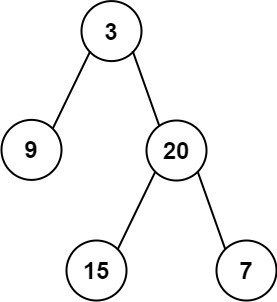

# 404. Sum of Left Leaves - LeetCode Python/Java/C++/JS/C#/Go/Ruby Solutions

> [**Build Your Programmer Brand at coder.id →**](https://www.coder.id)

Visit original link: [404. Sum of Left Leaves - LeetCode Python/Java/C++/JS/C#/Go/Ruby Solutions](https://www.coder.id/leetcode/en/solutions/404-sum-of-left-leaves) for a better experience!

LeetCode link: [404. Sum of Left Leaves](https://leetcode.com/problems/sum-of-left-leaves), difficulty: **Easy**.

## LeetCode description of "404. Sum of Left Leaves"

Given the `root` of a binary tree, return *the sum of all left leaves.*

A **leaf** is a node with no children. A **left leaf** is a leaf that is the left child of another node.

### [Example 1]



**Input**: `root = [3,9,20,null,null,15,7]`

**Output**: `24`

**Explanation**: 

<p>There are two left leaves in the binary tree, with values 9 and 15 respectively.</p>


### [Example 2]

**Input**: `root = [1]`

**Output**: `0`

### [Constraints]

- The number of nodes in the tree is in the range `[1, 1000]`.
- `-1000 <= Node.val <= 1000`

## Intuition


## Complexity

- Time complexity: `O(n)`.
- Space complexity: `O(n)`.

## Python

```python
# Definition for a binary tree node.
# class TreeNode:
#     def __init__(self, val=0, left=None, right=None):
#         self.val = val
#         self.left = left
#         self.right = right

class Solution:
    def sumOfLeftLeaves(self, root: Optional[TreeNode]) -> int:
        self.result = 0
        self.traverse(root, False)
        return self.result

    def traverse(self, node, is_left):
        if node is None:
            return
        
        if is_left_leaf(node, is_left):
            self.result += node.val
            return
        
        self.traverse(node.left, True)
        self.traverse(node.right, False)
        

def is_left_leaf(node, is_left):
    return is_left and node.left is None and node.right is None
```

## Other languages

```java
// Welcome to create a PR to complete the code of this language, thanks!
```

> 🚀 **Level Up Your Developer Identity**
>
> While mastering algorithms is key, showcasing your talent is what gets you hired.
>
> We recommend [**coder.id**](https://www.coder.id) — the ultimate all-in-one personal branding platform for programmers.
>
> **The All-In-One Career Powerhouse:**
> - 📄 **Resume, Portfolio & Blog:** Integrate your skills, GitHub projects, and writing into one stunning site.
> - 🌐 **Free Custom Domain:** Bind your own personal domain for free—forever.
> - ✨ **Premium Subdomains:** Stand out with elite tech handle like `name.coder.id`.
>
> [**Build Your Programmer Brand at coder.id →**](https://www.coder.id)

---

Visit original link: [404. Sum of Left Leaves - LeetCode Python/Java/C++/JS/C#/Go/Ruby Solutions](https://www.coder.id/leetcode/en/solutions/404-sum-of-left-leaves) for a better experience!

GitHub repository: [leetcode-python-java](https://github.com/leetcode-python-java/leetcode-python-java).

