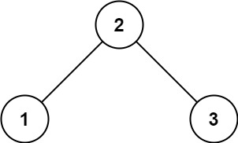
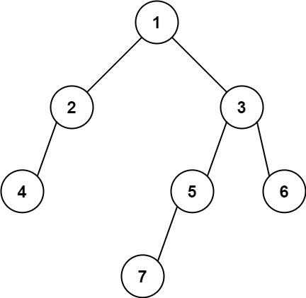

# 513. Find Bottom Left Tree Value - LeetCode Python/Java/C++/JS/C#/Go/Ruby Solutions

> [**Build Your Programmer Brand at coder.id →**](https://www.coder.id)

Visit original link: [513. Find Bottom Left Tree Value - LeetCode Python/Java/C++/JS/C#/Go/Ruby Solutions](https://www.coder.id/leetcode/en/solutions/513-find-bottom-left-tree-value) for a better experience!

LeetCode link: [513. Find Bottom Left Tree Value](https://leetcode.com/problems/find-bottom-left-tree-value), difficulty: **Medium**.

## LeetCode description of "513. Find Bottom Left Tree Value"

You are given the `root` of a binary tree.

Return the **leftmost** value in the **last** row of the tree.

### [Example 1]



**Input**: `root = [2,1,3]`

**Output**: `1`

**Explanation**: 

<p>The last row is [1,3], so the leftmost value is 1.</p>


### [Example 2]



**Input**: `root = [1,2,3,4,null,5,6,null,null,7]`

**Output**: `7`

**Explanation**: `The last row contains only the node 7.`

### [Constraints]

- The number of nodes in the tree is in the range `[1, 10^4]`.
- `-2^31 <= Node.val <= 2^31 - 1`

## Intuition


## Complexity

- Time complexity: `O(n)`.
- Space complexity: `O(n)`.

## Python

```python
# Definition for a binary tree node.
# class TreeNode:
#     def __init__(self, val=0, left=None, right=None):
#         self.val = val
#         self.left = left
#         self.right = right

class Solution:
    def findBottomLeftValue(self, root: TreeNode | None) -> int:
        queue = deque([root]) # Breadth First Search need a queue
        result = None

        while queue:
            for i in range(len(queue)): # Key. Go through this level's all nodes.
                node = queue.popleft()
                if i == 0:
                    result = node.val # The first of this level is the leftest node.
                if node.left:
                    queue.append(node.left)
                if node.right:
                    queue.append(node.right)

        return result
```

## Other languages

```java
// Welcome to create a PR to complete the code of this language, thanks!
```

> 🚀 **Level Up Your Developer Identity**
>
> While mastering algorithms is key, showcasing your talent is what gets you hired.
>
> We recommend [**coder.id**](https://www.coder.id) — the ultimate all-in-one personal branding platform for programmers.
>
> **The All-In-One Career Powerhouse:**
> - 📄 **Resume, Portfolio & Blog:** Integrate your skills, GitHub projects, and writing into one stunning site.
> - 🌐 **Free Custom Domain:** Bind your own personal domain for free—forever.
> - ✨ **Premium Subdomains:** Stand out with elite tech handle like `name.coder.id`.
>
> [**Build Your Programmer Brand at coder.id →**](https://www.coder.id)

---

Visit original link: [513. Find Bottom Left Tree Value - LeetCode Python/Java/C++/JS/C#/Go/Ruby Solutions](https://www.coder.id/leetcode/en/solutions/513-find-bottom-left-tree-value) for a better experience!

GitHub repository: [leetcode-python-java](https://github.com/leetcode-python-java/leetcode-python-java).

