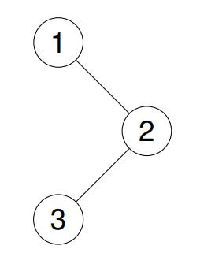
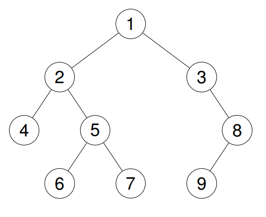

# 94. Binary Tree Inorder Traversal - LeetCode Python/Java/C++/JS/C#/Go/Ruby Solutions

> [**Build Your Programmer Brand at coder.id →**](https://www.coder.id)

Visit original link: [94. Binary Tree Inorder Traversal - LeetCode Python/Java/C++/JS/C#/Go/Ruby Solutions](https://www.coder.id/leetcode/en/solutions/94-binary-tree-inorder-traversal) for a better experience!

LeetCode link: [94. Binary Tree Inorder Traversal](https://leetcode.com/problems/binary-tree-inorder-traversal), difficulty: **Easy**.

## LeetCode description of "94. Binary Tree Inorder Traversal"

Given the `root` of a binary tree, return *the inorder traversal of its nodes' values*.

**Follow up:** Recursive solution is trivial, could you do it iteratively?

### [Example 1]



**Input**: `root = [1,null,2,3]`

**Output**: `[1,3,2]`

### [Example 2]



**Input**: `root = [1,2,3,4,5,null,8,null,null,6,7,9]`

**Output**: `[4,2,6,5,7,1,3,9,8]`

### [Example 3]

**Input**: `root = []`

**Output**: `[]`

### [Example 4]

**Input**: `root = [1]`

**Output**: `[1]`

### [Constraints]

- The number of nodes in the tree is in the range `[0, 100]`.
- `-100 <= Node.val <= 100`

## Intuition 1


## Complexity

- Time complexity: `O(n)`.
- Space complexity: `O(n)`.

## Python

```python
# Definition for a binary tree node.
# class TreeNode:
#     def __init__(self, val=0, left=None, right=None):
#         self.val = val
#         self.left = left
#         self.right = right

class Solution:
    def inorderTraversal(self, root: TreeNode | None) -> list[int]:
        self.result = []
        self.traverse(root)
        return self.result
    
    def traverse(self, node):
        if not node:
            return

        self.traverse(node.left)
        self.result.append(node.val)
        self.traverse(node.right)

```

## Other languages

```java
// Welcome to create a PR to complete the code of this language, thanks!
```

## Intuition 2


## Complexity

- Time complexity: `O(n)`.
- Space complexity: `O(n)`.

## Python

```python
# Definition for a binary tree node.
# class TreeNode:
#     def __init__(self, val=0, left=None, right=None):
#         self.val = val
#         self.left = left
#         self.right = right

class Solution:
    def inorderTraversal(self, root: TreeNode | None) -> list[int]:
        if root is None:
            return []

        stack = [(root, False)] # key 1
        result = []

        while stack:
            node, visited = stack.pop()

            if visited: # key 2
                result.append(node.val)
                continue
            
            if node.right:
                stack.append((node.right, False))
            
            stack.append((node, True)) # key 3

            if node.left:
                stack.append((node.left, False))

        return result
```

## Other languages

```java
// Welcome to create a PR to complete the code of this language, thanks!
```

> 🚀 **Level Up Your Developer Identity**
>
> While mastering algorithms is key, showcasing your talent is what gets you hired.
>
> We recommend [**coder.id**](https://www.coder.id) — the ultimate all-in-one personal branding platform for programmers.
>
> **The All-In-One Career Powerhouse:**
> - 📄 **Resume, Portfolio & Blog:** Integrate your skills, GitHub projects, and writing into one stunning site.
> - 🌐 **Free Custom Domain:** Bind your own personal domain for free—forever.
> - ✨ **Premium Subdomains:** Stand out with elite tech handle like `name.coder.id`.
>
> [**Build Your Programmer Brand at coder.id →**](https://www.coder.id)

---

Visit original link: [94. Binary Tree Inorder Traversal - LeetCode Python/Java/C++/JS/C#/Go/Ruby Solutions](https://www.coder.id/leetcode/en/solutions/94-binary-tree-inorder-traversal) for a better experience!

GitHub repository: [leetcode-python-java](https://github.com/leetcode-python-java/leetcode-python-java).

