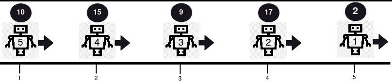
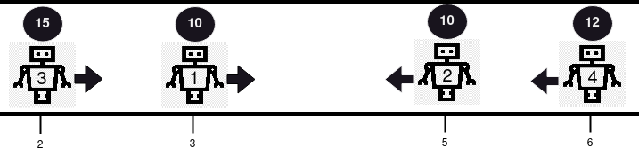
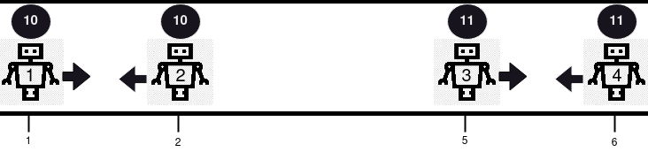

# 2751. Robot Collisions - LeetCode Python/Java/C++/JS/C#/Go/Ruby Solutions

> [**Build Your Programmer Brand at coder.id →**](https://www.coder.id)

Visit original link: [2751. Robot Collisions - LeetCode Python/Java/C++/JS/C#/Go/Ruby Solutions](https://www.coder.id/leetcode/en/solutions/2751-robot-collisions) for a better experience!

LeetCode link: [2751. Robot Collisions](https://leetcode.com/problems/robot-collisions), difficulty: **Hard**.

## LeetCode description of "2751. Robot Collisions"

There are `n` **1-indexed** robots, each having a position on a line, health, and movement direction.

You are given **0-indexed** integer arrays `positions`, `healths`, and a string `directions` (`directions[i]` is either **'L'** for **left** or **'R'** for **right**). All integers in `positions` are **unique**.

All robots start moving on the line **simultaneously** at the **same speed** in their given directions. If two robots ever share the same position while moving, they will **collide**.

If two robots collide, the robot with **lower health** is **removed** from the line, and the health of the other robot **decreases by one**. The surviving robot continues in the **same** direction it was going. If both robots have the **same** health, they are both removed from the line.

Your task is to determine the **health** of the robots that survive the collisions, in the same **order** that the robots were given, i.e. final health of robot 1 (if survived), final health of robot 2 (if survived), and so on. If there are no survivors, return an empty array.

Return *an array containing the health of the remaining robots (in the order they were given in the input), after no further collisions can occur.*

**Note:** The positions may be unsorted.

### [Example 1]



**Input**: `positions = [5,4,3,2,1], healths = [2,17,9,15,10], directions = "RRRRR"`

**Output**: `[2,17,9,15,10]`

**Explanation**: 

<p>No collision occurs in this example, since all robots are moving in the same direction. So, the health of the robots in order from the first robot is returned, [2, 17, 9, 15, 10].</p>


### [Example 2]



**Input**: `positions = [3,5,2,6], healths = [10,10,15,12], directions = "RLRL"`

**Output**: `[14]`

**Explanation**: 

<p>There are 2 collisions in this example. Firstly, robot 1 and robot 2 will collide, and since both have the same health, they will be removed from the line. Next, robot 3 and robot 4 will collide and since robot 4&#39;s health is smaller, it gets removed, and robot 3&#39;s health becomes 15 - 1 = 14. Only robot 3 remains, so we return [14].</p>


### [Example 3]



**Input**: `positions = [1,2,5,6], healths = [10,10,11,11], directions = "RLRL"`

**Output**: `[]`

**Explanation**: 

<p>Robot 1 and robot 2 will collide and since both have the same health, they are both removed. Robot 3 and 4 will collide and since both have the same health, they are both removed. So, we return an empty array, [].</p>


### [Constraints]

- `1 <= positions.length == healths.length == directions.length == n <= 10^5`
- `1 <= positions[i], healths[i] <= 10^9`
- `directions[i] == 'L'` or `directions[i] == 'R'`
- All values in `positions` are distinct

### [Hints]

<details>
  <summary>Hint 1</summary>
  Process the robots in the order of their positions to ensure that we process the collisions correctly.

  
</details>

<details>
  <summary>Hint 2</summary>
  To optimize the solution, use a stack to keep track of the surviving robots as we iterate through the positions.

  
</details>

<details>
  <summary>Hint 3</summary>
  Instead of simulating each collision, check the current robot against the top of the stack (if it exists) to determine if a collision occurs.

  
</details>

## Intuition

The problem involves robots moving on a line and colliding when they meet.

Since robots only collide if a right-moving robot meets a left-moving robot, this naturally suggests using a Stack. 

However, because the input positions are unsorted, we must first sort the robots by their positions to simulate the process from left to right.

To return the final healths in the original order, we need to keep track of the original indices of the robots before sorting.

## Step-by-Step Solution

1. **Bundle and Sort:** Create a list of robot objects or tuples containing `(position, health, direction, original_index)`. Sort this list primarily by `position`.
2. **Stack Simulation:** Initialize an empty stack. Iterate through the sorted robots:
   - If the robot is moving Right ('R'), push it onto the stack.
   - If the robot is moving Left ('L'), check for collisions with any 'R' robots currently on the stack.
3. **Handle Collisions:** While the stack is not empty, the top of the stack is an 'R' robot, and the current 'L' robot still has health > 0:
   - If the top 'R' robot has **more** health: the 'L' robot dies (health becomes 0), and the top 'R' robot's health decreases by 1.
   - If the top 'R' robot has **less** health: the top 'R' robot dies (pop from stack), and the 'L' robot's health decreases by 1. Continue checking the next robot on the stack.
   - If they have the **same** health: both die. Pop the 'R' robot from the stack, and the 'L' robot's health becomes 0.
4. **Surviving Left Robots:** If the 'L' robot survives all collisions (its health > 0), push it onto the stack.
5. **Restore Original Order:** After processing all robots, sort the remaining robots in the stack by their `original_index`.
6. **Extract Result:** Iterate through the re-sorted stack and extract their health values into the final answer array.

## Complexity

> - **Time Complexity:** Sorting the robots initially takes `O(N log N)` time. The simulation processes each robot, pushing and popping it from the stack at most once, which takes `O(N)` time. Finally, sorting the surviving robots back to their original order takes `O(N log N)` time. Thus, the overall time complexity is dominated by sorting, `O(N log N)`.
- **Space Complexity:** We create an array/list of structures to store the bundled robot data, which takes `O(N)` space. The stack can also hold up to `N` robots in the worst case, taking `O(N)` space. Thus, the overall space complexity is `O(N)`.

- Time complexity: `O(N log N)`.
- Space complexity: `O(N)`.

## Python

```python
class Solution:
    def survivedRobotsHealths(self, positions: List[int], healths: List[int], directions: str) -> List[int]:
        n = len(positions)
        # Store original indices to restore order later
        # We pair (position, health, direction, original_index)
        robots = []
        for i in range(n):
            robots.append([positions[i], healths[i], directions[i], i])
            
        # Sort robots by their positions from left to right
        robots.sort(key=lambda x: x[0])
        
        stack = [] # This will store the surviving robots
        
        for robot in robots:
            pos, health, dir, idx = robot
            
            if dir == 'R':
                # Right-moving robots are just added to the stack
                # They might collide with future Left-moving robots
                stack.append(robot)
            else:
                # Left-moving robot, check for collisions
                while stack and stack[-1][2] == 'R' and health > 0:
                    top_health = stack[-1][1]
                    
                    if top_health > health:
                        # Top robot survives, health decreases by 1
                        stack[-1][1] -= 1
                        health = 0 # Current robot is destroyed
                    elif top_health < health:
                        # Current robot survives, health decreases by 1
                        stack.pop() # Top robot is destroyed
                        health -= 1
                    else:
                        # Both have the same health, both are destroyed
                        stack.pop()
                        health = 0
                
                # If the Left-moving robot survived all collisions, add it to the stack
                if health > 0:
                    robot[1] = health # Update the health in the robot list
                    stack.append(robot)
                    
        # Sort the surviving robots by their original indices
        stack.sort(key=lambda x: x[3])
        
        # Return only the healths
        return [robot[1] for robot in stack]
```

## Ruby

```ruby
# @param {Integer[]} positions
# @param {Integer[]} healths
# @param {String} directions
# @return {Integer[]}
def survived_robots_healths(positions, healths, directions)
  n = positions.length
  
  # Bundle the attributes together with the original index
  robots = (0...n).map do |i|
    { pos: positions[i], health: healths[i], dir: directions[i], idx: i }
  end
  
  # Sort robots from left to right based on position
  robots.sort_by! { |r| r[:pos] }
  
  stack = []
  
  robots.each do |robot|
    if robot[:dir] == 'R'
      # Push right-moving robots to the stack to wait for potential collisions
      stack.push(robot)
    else
      # Handle collisions for a left-moving robot
      while !stack.empty? && stack.last[:dir] == 'R' && robot[:health] > 0
        top_robot = stack.last
        
        if top_robot[:health] > robot[:health]
          # The right-moving robot in stack survives
          top_robot[:health] -= 1
          robot[:health] = 0
        elsif top_robot[:health] < robot[:health]
          # The current left-moving robot survives
          stack.pop
          robot[:health] -= 1
        else
          # Both robots have the same health, both are destroyed
          stack.pop
          robot[:health] = 0
        end
      end
      
      # If the left-moving robot survived, it can continue moving left safely
      stack.push(robot) if robot[:health] > 0
    end
  end
  
  # Restore the original order of the surviving robots
  stack.sort_by! { |r| r[:idx] }
  
  # Extract and return the final healths
  stack.map { |r| r[:health] }
end
```

## JavaScript

```javascript
/**
 * @param {number[]} positions
 * @param {number[]} healths
 * @param {string} directions
 * @return {number[]}
 */
var survivedRobotsHealths = function(positions, healths, directions) {
    const n = positions.length;
    // Bundle the data with the original index
    const robots = [];
    for (let i = 0; i < n; i++) {
        robots.push({
            pos: positions[i],
            health: healths[i],
            dir: directions[i],
            idx: i
        });
    }
    
    // Sort robots by position (ascending order)
    robots.sort((a, b) => a.pos - b.pos);
    
    const stack = [];
    
    for (const robot of robots) {
        if (robot.dir === 'R') {
            // Right-moving robots wait in the stack
            stack.push(robot);
        } else {
            // Left-moving robot, process collisions
            while (stack.length > 0 && stack[stack.length - 1].dir === 'R' && robot.health > 0) {
                const topRobot = stack[stack.length - 1];
                
                if (topRobot.health > robot.health) {
                    // Right-moving robot wins
                    topRobot.health -= 1;
                    robot.health = 0;
                } else if (topRobot.health < robot.health) {
                    // Left-moving robot wins
                    stack.pop();
                    robot.health -= 1;
                } else {
                    // Draw: both destroyed
                    stack.pop();
                    robot.health = 0;
                }
            }
            
            // If the left-moving robot survives, push it to stack
            if (robot.health > 0) {
                stack.push(robot);
            }
        }
    }
    
    // Restore the original order based on idx
    stack.sort((a, b) => a.idx - b.idx);
    
    // Map to just their healths
    return stack.map(r => r.health);
};
```

## Java

```java
class Solution {
    // Helper class to encapsulate robot details
    static class Robot {
        int pos;
        int health;
        char dir;
        int idx;
        
        Robot(int pos, int health, char dir, int idx) {
            this.pos = pos;
            this.health = health;
            this.dir = dir;
            this.idx = idx;
        }
    }
    
    public List<Integer> survivedRobotsHealths(int[] positions, int[] healths, String directions) {
        int n = positions.length;
        Robot[] robots = new Robot[n];
        
        // Bundle attributes
        for (int i = 0; i < n; i++) {
            robots[i] = new Robot(positions[i], healths[i], directions.charAt(i), i);
        }
        
        // Sort robots by position
        Arrays.sort(robots, (a, b) -> Integer.compare(a.pos, b.pos));
        
        // Use a stack to simulate collisions
        List<Robot> stack = new ArrayList<>();
        
        for (Robot robot : robots) {
            if (robot.dir == 'R') {
                stack.add(robot);
            } else {
                // Collide with right-moving robots
                while (!stack.isEmpty() && stack.get(stack.size() - 1).dir == 'R' && robot.health > 0) {
                    Robot topRobot = stack.get(stack.size() - 1);
                    
                    if (topRobot.health > robot.health) {
                        topRobot.health -= 1;
                        robot.health = 0; // Current robot is destroyed
                    } else if (topRobot.health < robot.health) {
                        stack.remove(stack.size() - 1); // Top robot is destroyed
                        robot.health -= 1;
                    } else {
                        // Both are destroyed
                        stack.remove(stack.size() - 1);
                        robot.health = 0;
                    }
                }
                
                // If current left-moving robot survives
                if (robot.health > 0) {
                    stack.add(robot);
                }
            }
        }
        
        // Sort surviving robots back to their original input order
        stack.sort((a, b) -> Integer.compare(a.idx, b.idx));
        
        // Extract the health values
        List<Integer> result = new ArrayList<>();
        for (Robot robot : stack) {
            result.add(robot.health);
        }
        
        return result;
    }
}
```

## Cpp

```cpp
#include <vector>
#include <string>
#include <numeric>
#include <algorithm>

using namespace std;

class Solution {
    struct Robot {
        int pos;
        int health;
        char dir;
        int idx;
    };
    
public:
    vector<int> survivedRobotsHealths(vector<int>& positions, vector<int>& healths, string directions) {
        int n = positions.size();
        vector<Robot> robots;
        robots.reserve(n);
        
        // Populate the robots vector
        for (int i = 0; i < n; ++i) {
            robots.push_back({positions[i], healths[i], directions[i], i});
        }
        
        // Sort based on position
        sort(robots.begin(), robots.end(), [](const Robot& a, const Robot& b) {
            return a.pos < b.pos;
        });
        
        vector<Robot> stack;
        
        for (auto& robot : robots) {
            if (robot.dir == 'R') {
                stack.push_back(robot);
            } else {
                // Resolve collisions for left-moving robot
                while (!stack.empty() && stack.back().dir == 'R' && robot.health > 0) {
                    if (stack.back().health > robot.health) {
                        stack.back().health -= 1;
                        robot.health = 0;
                    } else if (stack.back().health < robot.health) {
                        stack.pop_back();
                        robot.health -= 1;
                    } else {
                        stack.pop_back();
                        robot.health = 0;
                    }
                }
                
                if (robot.health > 0) {
                    stack.push_back(robot);
                }
            }
        }
        
        // Restore original order
        sort(stack.begin(), stack.end(), [](const Robot& a, const Robot& b) {
            return a.idx < b.idx;
        });
        
        // Construct the result
        vector<int> result;
        result.reserve(stack.size());
        for (const auto& robot : stack) {
            result.push_back(robot.health);
        }
        
        return result;
    }
};
```

## Csharp

```csharp
using System;
using System.Collections.Generic;

public class Solution {
    // Structure to hold robot details
    class Robot {
        public int pos;
        public int health;
        public char dir;
        public int idx;
        
        public Robot(int p, int h, char d, int i) {
            pos = p;
            health = h;
            dir = d;
            idx = i;
        }
    }
    
    public IList<int> SurvivedRobotsHealths(int[] positions, int[] healths, string directions) {
        int n = positions.Length;
        Robot[] robots = new Robot[n];
        
        for (int i = 0; i < n; i++) {
            robots[i] = new Robot(positions[i], healths[i], directions[i], i);
        }
        
        // Sort by position
        Array.Sort(robots, (a, b) => a.pos.CompareTo(b.pos));
        
        List<Robot> stack = new List<Robot>();
        
        foreach (var robot in robots) {
            if (robot.dir == 'R') {
                stack.Add(robot);
            } else {
                // Process collisions
                while (stack.Count > 0 && stack[^1].dir == 'R' && robot.health > 0) {
                    Robot topRobot = stack[^1];
                    
                    if (topRobot.health > robot.health) {
                        topRobot.health--;
                        robot.health = 0;
                    } else if (topRobot.health < robot.health) {
                        stack.RemoveAt(stack.Count - 1);
                        robot.health--;
                    } else {
                        stack.RemoveAt(stack.Count - 1);
                        robot.health = 0;
                    }
                }
                
                if (robot.health > 0) {
                    stack.Add(robot);
                }
            }
        }
        
        // Sort back to original indices
        stack.Sort((a, b) => a.idx.CompareTo(b.idx));
        
        List<int> result = new List<int>();
        foreach (var robot in stack) {
            result.Add(robot.health);
        }
        
        return result;
    }
}
```

## Go

```go
package main

import (
	"sort"
)

type Robot struct {
	pos    int
	health int
	dir    byte
	idx    int
}

func survivedRobotsHealths(positions []int, healths []int, directions string) []int {
	n := len(positions)
	robots := make([]Robot, n)
	
	for i := 0; i < n; i++ {
		robots[i] = Robot{
			pos:    positions[i],
			health: healths[i],
			dir:    directions[i],
			idx:    i,
		}
	}
	
	// Sort robots by position
	sort.Slice(robots, func(i, j int) bool {
		return robots[i].pos < robots[j].pos
	})
	
	var stack []Robot
	
	for _, robot := range robots {
		if robot.dir == 'R' {
			stack = append(stack, robot)
		} else {
			// Process left-moving robot
			for len(stack) > 0 && stack[len(stack)-1].dir == 'R' && robot.health > 0 {
				top := stack[len(stack)-1]
				
				if top.health > robot.health {
					stack[len(stack)-1].health--
					robot.health = 0
				} else if top.health < robot.health {
					stack = stack[:len(stack)-1]
					robot.health--
				} else {
					stack = stack[:len(stack)-1]
					robot.health = 0
				}
			}
			
			if robot.health > 0 {
				stack = append(stack, robot)
			}
		}
	}
	
	// Sort remaining robots by their original index
	sort.Slice(stack, func(i, j int) bool {
		return stack[i].idx < stack[j].idx
	})
	
	result := make([]int, len(stack))
	for i, robot := range stack {
		result[i] = robot.health
	}
	
	return result
}
```

## Rust

```rust
impl Solution {
    pub fn survived_robots_healths(positions: Vec<i32>, healths: Vec<i32>, directions: String) -> Vec<i32> {
        let n = positions.len();
        let mut robots: Vec<(i32, i32, char, usize)> = Vec::with_capacity(n);
        let dirs: Vec<char> = directions.chars().collect();
        
        // Bundle attributes: (position, health, direction, original_index)
        for i in 0..n {
            robots.push((positions[i], healths[i], dirs[i], i));
        }
        
        // Sort by position
        robots.sort_by_key(|r| r.0);
        
        let mut stack: Vec<(i32, i32, char, usize)> = Vec::new();
        
        for mut robot in robots {
            if robot.2 == 'R' {
                stack.push(robot);
            } else {
                let mut survived = true;
                
                while let Some(top) = stack.last_mut() {
                    if top.2 != 'R' { break; }
                    
                    if top.1 > robot.1 {
                        top.1 -= 1;
                        survived = false;
                        break;
                    } else if top.1 < robot.1 {
                        stack.pop();
                        robot.1 -= 1;
                    } else {
                        stack.pop();
                        survived = false;
                        break;
                    }
                }
                
                if survived {
                    stack.push(robot);
                }
            }
        }
        
        // Restore original order
        stack.sort_by_key(|r| r.3);
        
        stack.into_iter().map(|r| r.1).collect()
    }
}
```

## Kotlin

```kotlin
class Solution {
    class Robot(var pos: Int, var health: Int, var dir: Char, var idx: Int)

    fun survivedRobotsHealths(positions: IntArray, healths: IntArray, directions: String): List<Int> {
        val n = positions.size
        val robots = Array(n) { i ->
            Robot(positions[i], healths[i], directions[i], i)
        }
        
        // Sort robots based on their position
        robots.sortBy { it.pos }
        
        val stack = mutableListOf<Robot>()
        
        for (robot in robots) {
            if (robot.dir == 'R') {
                stack.add(robot)
            } else {
                var isAlive = true
                while (stack.isNotEmpty() && stack.last().dir == 'R' && robot.health > 0) {
                    val topRobot = stack.last()
                    
                    if (topRobot.health > robot.health) {
                        topRobot.health -= 1
                        robot.health = 0
                        isAlive = false
                    } else if (topRobot.health < robot.health) {
                        stack.removeAt(stack.size - 1)
                        robot.health -= 1
                    } else {
                        stack.removeAt(stack.size - 1)
                        robot.health = 0
                        isAlive = false
                    }
                }
                
                if (isAlive && robot.health > 0) {
                    stack.add(robot)
                }
            }
        }
        
        // Sort by the original indices
        stack.sortBy { it.idx }
        
        return stack.map { it.health }
    }
}
```

## Swift

```swift
class Solution {
    struct Robot {
        var pos: Int
        var health: Int
        var dir: Character
        var idx: Int
    }
    
    func survivedRobotsHealths(_ positions: [Int], _ healths: [Int], _ directions: String) -> [Int] {
        let n = positions.count
        var robots: [Robot] = []
        let dirArray = Array(directions)
        
        // Bundle attributes
        for i in 0..<n {
            robots.append(Robot(pos: positions[i], health: healths[i], dir: dirArray[i], idx: i))
        }
        
        // Sort by position
        robots.sort { $0.pos < $1.pos }
        
        var stack: [Robot] = []
        
        for i in 0..<robots.count {
            var robot = robots[i]
            
            if robot.dir == "R" {
                stack.append(robot)
            } else {
                while !stack.isEmpty && stack.last!.dir == "R" && robot.health > 0 {
                    let topIdx = stack.count - 1
                    
                    if stack[topIdx].health > robot.health {
                        stack[topIdx].health -= 1
                        robot.health = 0
                    } else if stack[topIdx].health < robot.health {
                        stack.removeLast()
                        robot.health -= 1
                    } else {
                        stack.removeLast()
                        robot.health = 0
                    }
                }
                
                if robot.health > 0 {
                    stack.append(robot)
                }
            }
        }
        
        // Sort back to original order
        stack.sort { $0.idx < $1.idx }
        
        return stack.map { $0.health }
    }
}
```

## Other languages

```java
// Welcome to create a PR to complete the code of this language, thanks!
```

> 🚀 **Level Up Your Developer Identity**
>
> While mastering algorithms is key, showcasing your talent is what gets you hired.
>
> We recommend [**coder.id**](https://www.coder.id) — the ultimate all-in-one personal branding platform for programmers.
>
> **The All-In-One Career Powerhouse:**
> - 📄 **Resume, Portfolio & Blog:** Integrate your skills, GitHub projects, and writing into one stunning site.
> - 🌐 **Free Custom Domain:** Bind your own personal domain for free—forever.
> - ✨ **Premium Subdomains:** Stand out with elite tech handle like `name.coder.id`.
>
> [**Build Your Programmer Brand at coder.id →**](https://www.coder.id)

---

Visit original link: [2751. Robot Collisions - LeetCode Python/Java/C++/JS/C#/Go/Ruby Solutions](https://www.coder.id/leetcode/en/solutions/2751-robot-collisions) for a better experience!

GitHub repository: [leetcode-python-java](https://github.com/leetcode-python-java/leetcode-python-java).

