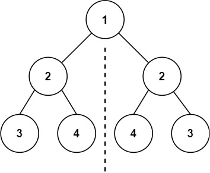
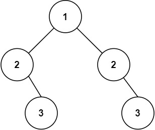

# 101. 对称二叉树 - LeetCode Python/Java/C++/JS/C#/Go/Ruby 题解

> [**前往 coder.id 打造你的开发者个人IP →**](https://www.coder.id)

访问原文链接：[101. 对称二叉树 - LeetCode Python/Java/C++/JS/C#/Go/Ruby 题解](https://www.coder.id/leetcode/zh/solutions/101-symmetric-tree)，体验更佳！

力扣链接：[101. 对称二叉树](https://leetcode.cn/problems/symmetric-tree), 难度等级：**简单**。

## LeetCode “101. 对称二叉树”问题描述

给你一个二叉树的根节点 `root` ， 检查它是否轴对称。

**进阶：**你可以运用递归和迭代两种方法解决这个问题吗？

### [示例 1]



**输入**: `root = [1,2,2,3,4,4,3]`

**输出**: `true`

### [示例 2]



**输入**: `root = [1,2,2,null,3,null,3]`

**输出**: `false`

### [约束]

- 树中节点数目在范围 `[1, 1000]` 内
- `-100 <= Node.val <= 100`

## 思路


## 复杂度

- 时间复杂度: `O(n)`.
- 空间复杂度: `O(n)`.

## Python

```python
# Definition for a binary tree node.
# class TreeNode:
#     def __init__(self, val=0, left=None, right=None):
#         self.val = val
#         self.left = left
#         self.right = right

class Solution:
    def isSymmetric(self, root: TreeNode | None) -> bool:
        return is_symmetric(root.left, root.right)

def is_symmetric(node1, node2):
    if node1 is None or node2 is None:
        return node1 is None and node2 is None

    if node1.val != node2.val:
        return False

    return is_symmetric(node1.left, node2.right) and is_symmetric(node1.right, node2.left)
```

## Other languages

```java
// Welcome to create a PR to complete the code of this language, thanks!
```

> 🚀 **打造你的开发者个人IP**
>
> 掌握算法是成功的基石，而全方位展示你的才华则是获得垂青的关键。
>
> 我的另一个项目 [**coder.id**](https://www.coder.id) —— 专为程序员打造的“全能型”个人品牌展示平台。
>
> **三位一体（All-In-One）的职场利器：**
> - 📄 **简历 + 作品集 + 博客：** 将你的 GitHub 项目、技术心得与职场经历完美融合。
> - 🌐 **永久免费自定义域名：** 支持绑定你自己的独立域名，且该功能永久免费。
> - ✨ **顶级行业子域名：** 提供 `name.coder.id`，极具职业含金量的专属域名。

>
> [**立即前往 coder.id 打造你的个人品牌 →**](https://www.coder.id)

---

访问原文链接：[101. 对称二叉树 - LeetCode Python/Java/C++/JS/C#/Go/Ruby 题解](https://www.coder.id/leetcode/zh/solutions/101-symmetric-tree)，体验更佳！

GitHub 仓库: [leetcode-python-java](https://github.com/leetcode-python-java/leetcode-python-java).

