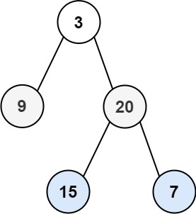

# 102. 二叉树的层序遍历 - LeetCode Python/Java/C++/JS/C#/Go/Ruby 题解

> [**前往 coder.id 打造你的开发者个人IP →**](https://www.coder.id)

访问原文链接：[102. 二叉树的层序遍历 - LeetCode Python/Java/C++/JS/C#/Go/Ruby 题解](https://www.coder.id/leetcode/zh/solutions/102-binary-tree-level-order-traversal)，体验更佳！

力扣链接：[102. 二叉树的层序遍历](https://leetcode.cn/problems/binary-tree-level-order-traversal), 难度等级：**中等**。

## LeetCode “102. 二叉树的层序遍历”问题描述

给你二叉树的根节点 `root` ，返回其节点值的 **层序遍历** 。 （即逐层地，从左到右访问所有节点）。

### [示例 1]



**输入**: `root = [3,9,20,null,null,15,7]`

**输出**: `[[3],[9,20],[15,7]]`

### [示例 2]

**输入**: `root = [1]`

**输出**: `[[1]]`

### [示例 3]

**输入**: `root = []`

**输出**: `[]`

### [约束]

- 树中节点数目在范围 `[0, 2000]` 内
- `-1000 <= Node.val <= 1000`

### [Hints]

<details>
  <summary>提示 1</summary>
  Use a queue to perform BFS.

  
</details>

## 思路


## 复杂度

- 时间复杂度: `O(n)`.
- 空间复杂度: `O(n)`.

## Python

```python
# Definition for a binary tree node.
# class TreeNode:
#     def __init__(self, val=0, left=None, right=None):
#         self.val = val
#         self.left = left
#         self.right = right


class Solution:
    def levelOrder(self, root: TreeNode | None) -> list[list[int]]:
        if root is None:
            return []

        results = []
        queue = deque([root]) # key 1. Breadth First Search need a queue.

        while queue:
            size = len(queue)
            result = []
            
            for _ in range(size): # key 2: Go through all nodes (previous level) in queue.
                node = queue.popleft()
                result.append(node.val)

                if node.left:
                    queue.append(node.left)
                if node.right:
                    queue.append(node.right)
            
            results.append(result.copy())
        
        return results
```

## Other languages

```java
// Welcome to create a PR to complete the code of this language, thanks!
```

> 🚀 **打造你的开发者个人IP**
>
> 掌握算法是成功的基石，而全方位展示你的才华则是获得垂青的关键。
>
> 我的另一个项目 [**coder.id**](https://www.coder.id) —— 专为程序员打造的“全能型”个人品牌展示平台。
>
> **三位一体（All-In-One）的职场利器：**
> - 📄 **简历 + 作品集 + 博客：** 将你的 GitHub 项目、技术心得与职场经历完美融合。
> - 🌐 **永久免费自定义域名：** 支持绑定你自己的独立域名，且该功能永久免费。
> - ✨ **顶级行业子域名：** 提供 `name.coder.id`，极具职业含金量的专属域名。

>
> [**立即前往 coder.id 打造你的个人品牌 →**](https://www.coder.id)

---

访问原文链接：[102. 二叉树的层序遍历 - LeetCode Python/Java/C++/JS/C#/Go/Ruby 题解](https://www.coder.id/leetcode/zh/solutions/102-binary-tree-level-order-traversal)，体验更佳！

GitHub 仓库: [leetcode-python-java](https://github.com/leetcode-python-java/leetcode-python-java).

