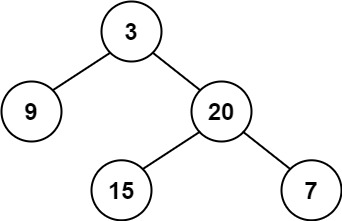
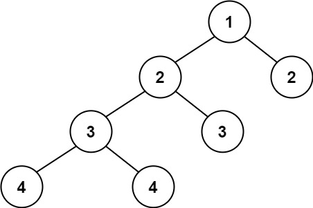

# 110. 平衡二叉树 - LeetCode Python/Java/C++/JS/C#/Go/Ruby 题解

> [**前往 coder.id 打造你的开发者个人IP →**](https://www.coder.id)

访问原文链接：[110. 平衡二叉树 - LeetCode Python/Java/C++/JS/C#/Go/Ruby 题解](https://www.coder.id/leetcode/zh/solutions/110-balanced-binary-tree)，体验更佳！

力扣链接：[110. 平衡二叉树](https://leetcode.cn/problems/balanced-binary-tree), 难度等级：**简单**。

## LeetCode “110. 平衡二叉树”问题描述

给定一个二叉树，判断它是否是 **平衡二叉树**。

### [示例 1]



**输入**: `root = [3,9,20,null,null,15,7]`

**输出**: `true`

### [示例 2]



**输入**: `root = [1,2,2,3,3,null,null,4,4]`

**输出**: `false`

### [示例 3]

**输入**: `root = []`

**输出**: `true`

### [约束]

- 树中的节点数在范围 `[0, 5000]` 内
- `-10^4 <= Node.val <= 10^4`

## 思路


## 复杂度

- 时间复杂度: `O(log n)`.
- 空间复杂度: `O(log n)`.

## Python

```python
# Definition for a binary tree node.
# class TreeNode:
#     def __init__(self, val=0, left=None, right=None):
#         self.val = val
#         self.left = left
#         self.right = right

class Solution:
    def isBalanced(self, root: TreeNode | None) -> bool:
        if root is None:
            return True

        return abs(get_depth(root.left) - get_depth(root.right)) <= 1


def get_depth(node):
    if node is None:
        return 0
    
    return max(get_depth(node.left), get_depth(node.right)) + 1
```

## Other languages

```java
// Welcome to create a PR to complete the code of this language, thanks!
```

> 🚀 **打造你的开发者个人IP**
>
> 掌握算法是成功的基石，而全方位展示你的才华则是获得垂青的关键。
>
> 我的另一个项目 [**coder.id**](https://www.coder.id) —— 专为程序员打造的“全能型”个人品牌展示平台。
>
> **三位一体（All-In-One）的职场利器：**
> - 📄 **简历 + 作品集 + 博客：** 将你的 GitHub 项目、技术心得与职场经历完美融合。
> - 🌐 **永久免费自定义域名：** 支持绑定你自己的独立域名，且该功能永久免费。
> - ✨ **顶级行业子域名：** 提供 `name.coder.id`，极具职业含金量的专属域名。

>
> [**立即前往 coder.id 打造你的个人品牌 →**](https://www.coder.id)

---

访问原文链接：[110. 平衡二叉树 - LeetCode Python/Java/C++/JS/C#/Go/Ruby 题解](https://www.coder.id/leetcode/zh/solutions/110-balanced-binary-tree)，体验更佳！

GitHub 仓库: [leetcode-python-java](https://github.com/leetcode-python-java/leetcode-python-java).

