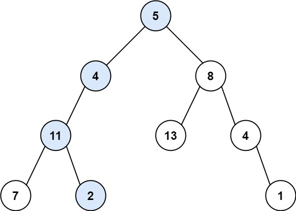
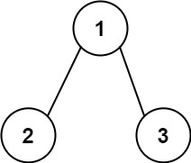

# 112. 路径总和 - LeetCode Python/Java/C++/JS/C#/Go/Ruby 题解

> [**前往 coder.id 打造你的开发者个人IP →**](https://www.coder.id)

访问原文链接：[112. 路径总和 - LeetCode Python/Java/C++/JS/C#/Go/Ruby 题解](https://www.coder.id/leetcode/zh/solutions/112-path-sum)，体验更佳！

力扣链接：[112. 路径总和](https://leetcode.cn/problems/path-sum), 难度等级：**简单**。

## LeetCode “112. 路径总和”问题描述

给你二叉树的根节点 `root` 和一个表示目标和的整数 `targetSum` 。判断该树中是否存在 **根节点到叶子节点** 的路径，这条路径上所有节点值相加等于目标和 `targetSum` 。如果存在，返回 `true` ；否则，返回 `false` 。

**叶子节点** 是指没有子节点的节点。

### [示例 1]



**输入**: `root = [5,4,8,11,null,13,4,7,2,null,null,null,1], targetSum = 22`

**输出**: `true`

**解释**: `等于目标和的根节点到叶节点路径如上图所示。`

### [示例 2]



**输入**: `root = [1,2,3], targetSum = 5`

**输出**: `false`

**解释**: 

<div class="highlight"><pre class="highlight plaintext"><code>树中存在两条根节点到叶子节点的路径：
(1 --&gt; 2): 和为 3
(1 --&gt; 3): 和为 4
不存在 sum = 5 的根节点到叶子节点的路径。
</code></pre></div>

### [示例 3]

**输入**: `root = [], targetSum = 0`

**输出**: `false`

**解释**: `由于树是空的，所以不存在根节点到叶子节点的路径。`

### [约束]

- 树中节点的数目在范围 `[0, 5000]` 内
- `-1000 <= Node.val <= 1000`
- `-1000 <= targetSum <= 1000`

## 思路 1


## 复杂度

- 时间复杂度: `O(n)`.
- 空间复杂度: `O(n)`.

## Python

```python
# Definition for a binary tree node.
# class TreeNode:
#     def __init__(self, val=0, left=None, right=None):
#         self.val = val
#         self.left = left
#         self.right = right

class Solution:
    def hasPathSum(self, root: TreeNode | None, targetSum: int) -> bool:
        if root is None:
            return False

        self.target_sum = targetSum
        self.result = False
        self.sum_ = root.val
        self.traverse(root)
        return self.result

    def traverse(self, node):
        if self.result:
            return

        if is_leaf(node) and self.sum_ == self.target_sum:
            self.result = True
            return
        
        if node.left:
            self.sum_ += node.left.val
            self.traverse(node.left)
            self.sum_ -= node.left.val # Rollback

        if node.right:
            self.sum_ += node.right.val
            self.traverse(node.right)
            self.sum_ -= node.right.val # Rollback


def is_leaf(node):
    return node and node.left is None and node.right is None
```

## Other languages

```java
// Welcome to create a PR to complete the code of this language, thanks!
```

## 思路 2


## 复杂度

- 时间复杂度: `O(n)`.
- 空间复杂度: `O(n)`.

## Python

```python
# Definition for a binary tree node.
# class TreeNode:
#     def __init__(self, val=0, left=None, right=None):
#         self.val = val
#         self.left = left
#         self.right = right

class Solution:
    def hasPathSum(self, root: TreeNode | None, targetSum: int) -> bool:
        if root is None:
            return False

        self.target_sum = targetSum
        self.result = False
        self.traverse(root, root.val)
        return self.result

    def traverse(self, node, sum_):
        if self.result:
            return

        if is_leaf(node) and sum_ == self.target_sum:
            self.result = True
            return

        if node.left:
            self.traverse(node.left, sum_ + node.left.val)

        if node.right:
            self.traverse(node.right, sum_ + node.right.val)


def is_leaf(node):
    return node and node.left is None and node.right is None
```

## Other languages

```java
// Welcome to create a PR to complete the code of this language, thanks!
```

> 🚀 **打造你的开发者个人IP**
>
> 掌握算法是成功的基石，而全方位展示你的才华则是获得垂青的关键。
>
> 我的另一个项目 [**coder.id**](https://www.coder.id) —— 专为程序员打造的“全能型”个人品牌展示平台。
>
> **三位一体（All-In-One）的职场利器：**
> - 📄 **简历 + 作品集 + 博客：** 将你的 GitHub 项目、技术心得与职场经历完美融合。
> - 🌐 **永久免费自定义域名：** 支持绑定你自己的独立域名，且该功能永久免费。
> - ✨ **顶级行业子域名：** 提供 `name.coder.id`，极具职业含金量的专属域名。

>
> [**立即前往 coder.id 打造你的个人品牌 →**](https://www.coder.id)

---

访问原文链接：[112. 路径总和 - LeetCode Python/Java/C++/JS/C#/Go/Ruby 题解](https://www.coder.id/leetcode/zh/solutions/112-path-sum)，体验更佳！

GitHub 仓库: [leetcode-python-java](https://github.com/leetcode-python-java/leetcode-python-java).

