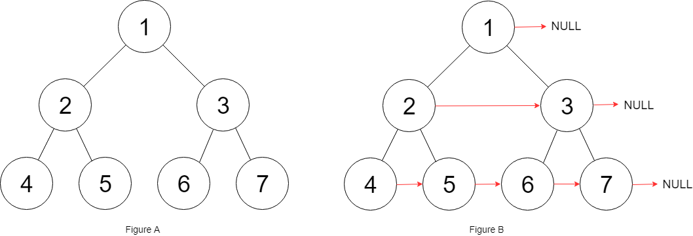

# 116. 填充每个节点的下一个右侧节点指针 - LeetCode Python/Java/C++/JS/C#/Go/Ruby 题解

> [**前往 coder.id 打造你的开发者个人IP →**](https://www.coder.id)

访问原文链接：[116. 填充每个节点的下一个右侧节点指针 - LeetCode Python/Java/C++/JS/C#/Go/Ruby 题解](https://www.coder.id/leetcode/zh/solutions/116-populating-next-right-pointers-in-each-node)，体验更佳！

力扣链接：[116. 填充每个节点的下一个右侧节点指针](https://leetcode.cn/problems/populating-next-right-pointers-in-each-node), 难度等级：**中等**。

## LeetCode “116. 填充每个节点的下一个右侧节点指针”问题描述

给定一个 **完美二叉树** ，其所有叶子节点都在同一层，每个父节点都有两个子节点。二叉树定义如下：

```
struct Node {
  int val;
  Node *left;
  Node *right;
  Node *next;
}
```

填充它的每个 next 指针，让这个指针指向其下一个右侧节点。如果找不到下一个右侧节点，则将 next 指针设置为 `NULL`。

初始状态下，所有 next 指针都被设置为 `NULL`。

**进阶：**

- 你只能使用常量级额外空间。
- 使用递归解题也符合要求，本题中递归程序占用的栈空间不算做额外的空间复杂度。

### [示例 1]



**输入**: `root = [1,2,3,4,5,6,7]`

**输出**: `[1,#,2,3,#,4,5,6,7,#]`

**解释**: 

<p>给定二叉树如图 A 所示，你的函数应该填充它的每个 next 指针，以指向其下一个右侧节点，如图 B 所示。序列化的输出按层序遍历排列，同一层节点由 next 指针连接，&#39;#&#39; 标志着每一层的结束。</p>


### [示例 2]

**输入**: `root = []`

**输出**: `[]`

### [示例 3]


**输入**: `root = [1,2,3,4,5,6,7]`

**输出**: `[1,#,2,3,#,4,5,6,7,#]`

**解释**: 

<p>给定二叉树如图 A 所示，你的函数应该填充它的每个 next 指针，以指向其下一个右侧节点，如图 B 所示。序列化的输出按层序遍历排列，同一层节点由 next 指针连接，&#39;#&#39; 标志着每一层的结束。</p>


### [示例 4]

**输入**: `root = []`

**输出**: `[]`

### [约束]

- 树中节点的数量在 `[0, 2^12 - 1]` 范围内
- `-1000 <= node.val <= 1000`

## 思路


## 复杂度

- 时间复杂度: `O(n)`.
- 空间复杂度: `O(n)`.

## Python

```python
"""
# Definition for a Node.
class Node:
    def __init__(self, val: int = 0, left: 'Node' = None, right: 'Node' = None, next: 'Node' = None):
        self.val = val
        self.left = left
        self.right = right
        self.next = next
"""

class Solution:
    def connect(self, root: 'Optional[Node]') -> 'Optional[Node]':
        if root is None:
            return

        queue = deque([root]) # key 1. Breadth First Search need a queue.

        while queue:
            size = len(queue)
            prev = None
            
            for _ in range(size): # key 2: Go through all nodes (previous level) in queue.
                node = queue.popleft()

                if prev:
                    prev.next = node # key 3

                prev = node # key 4

                if node.left:
                    queue.append(node.left)

                if node.right:
                    queue.append(node.right)
        
        return root
```

## Other languages

```java
// Welcome to create a PR to complete the code of this language, thanks!
```

> 🚀 **打造你的开发者个人IP**
>
> 掌握算法是成功的基石，而全方位展示你的才华则是获得垂青的关键。
>
> 我的另一个项目 [**coder.id**](https://www.coder.id) —— 专为程序员打造的“全能型”个人品牌展示平台。
>
> **三位一体（All-In-One）的职场利器：**
> - 📄 **简历 + 作品集 + 博客：** 将你的 GitHub 项目、技术心得与职场经历完美融合。
> - 🌐 **永久免费自定义域名：** 支持绑定你自己的独立域名，且该功能永久免费。
> - ✨ **顶级行业子域名：** 提供 `name.coder.id`，极具职业含金量的专属域名。

>
> [**立即前往 coder.id 打造你的个人品牌 →**](https://www.coder.id)

---

访问原文链接：[116. 填充每个节点的下一个右侧节点指针 - LeetCode Python/Java/C++/JS/C#/Go/Ruby 题解](https://www.coder.id/leetcode/zh/solutions/116-populating-next-right-pointers-in-each-node)，体验更佳！

GitHub 仓库: [leetcode-python-java](https://github.com/leetcode-python-java/leetcode-python-java).

