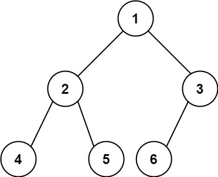

# 222. 完全二叉树的节点个数 - LeetCode Python/Java/C++/JS/C#/Go/Ruby 题解

> [**前往 coder.id 打造你的开发者个人IP →**](https://www.coder.id)

访问原文链接：[222. 完全二叉树的节点个数 - LeetCode Python/Java/C++/JS/C#/Go/Ruby 题解](https://www.coder.id/leetcode/zh/solutions/222-count-complete-tree-nodes)，体验更佳！

力扣链接：[222. 完全二叉树的节点个数](https://leetcode.cn/problems/count-complete-tree-nodes), 难度等级：**中等**。

## LeetCode “222. 完全二叉树的节点个数”问题描述

给你一棵 **完全二叉树** 的根节点 `root` ，求出该树的节点个数。

[完全二叉树](https://baike.baidu.com/item/%E5%AE%8C%E5%85%A8%E4%BA%8C%E5%8F%89%E6%A0%91/7773232?fr=aladdin) 的定义如下：在完全二叉树中，除了最底层节点可能没填满外，其余每层节点数都达到最大值，并且最下面一层的节点都集中在该层最左边的若干位置。若最底层为第 `h` 层（从第 0 层开始），则该层包含 `1~ 2^h` 个节点。

**进阶：** 遍历树来统计节点是一种时间复杂度为 `O(n)` 的简单解决方案。你可以设计一个更快的算法吗？

### [示例 1]



**输入**: `root = [1,2,3,4,5,6]`

**输出**: `6`

### [示例 2]

**输入**: `root = []`

**输出**: `0`

### [示例 3]

**输入**: `root = [1]`

**输出**: `1`

### [约束]

- 树中节点的数目范围是 `[0, 5 * 10^4]`
- `0 <= Node.val <= 5 * 10^4`
- 题目数据保证输入的树是 **完全二叉树**

## 思路


## 复杂度

- 时间复杂度: `O(log n)`.
- 空间复杂度: `O(log n)`.

## Python

```python
# Definition for a binary tree node.
# class TreeNode:
#     def __init__(self, val=0, left=None, right=None):
#         self.val = val
#         self.left = left
#         self.right = right

class Solution:
    def countNodes(self, root: Optional[TreeNode]) -> int:
        if root is None:
            return 0
        
        # calc depth_left
        node = root
        depth_left = 1
        while node.left:
            depth_left += 1
            node = node.left
        
        # calc depth_right
        node = root
        depth_right = 1
        while node.right:
            depth_right += 1
            node = node.right

        if depth_left == depth_right: # It is a full binary tree.
            return 2 ** depth_left - 1 # key

        return self.countNodes(root.left) + self.countNodes(root.right) + 1
```

## Other languages

```java
// Welcome to create a PR to complete the code of this language, thanks!
```

> 🚀 **打造你的开发者个人IP**
>
> 掌握算法是成功的基石，而全方位展示你的才华则是获得垂青的关键。
>
> 我的另一个项目 [**coder.id**](https://www.coder.id) —— 专为程序员打造的“全能型”个人品牌展示平台。
>
> **三位一体（All-In-One）的职场利器：**
> - 📄 **简历 + 作品集 + 博客：** 将你的 GitHub 项目、技术心得与职场经历完美融合。
> - 🌐 **永久免费自定义域名：** 支持绑定你自己的独立域名，且该功能永久免费。
> - ✨ **顶级行业子域名：** 提供 `name.coder.id`，极具职业含金量的专属域名。

>
> [**立即前往 coder.id 打造你的个人品牌 →**](https://www.coder.id)

---

访问原文链接：[222. 完全二叉树的节点个数 - LeetCode Python/Java/C++/JS/C#/Go/Ruby 题解](https://www.coder.id/leetcode/zh/solutions/222-count-complete-tree-nodes)，体验更佳！

GitHub 仓库: [leetcode-python-java](https://github.com/leetcode-python-java/leetcode-python-java).

