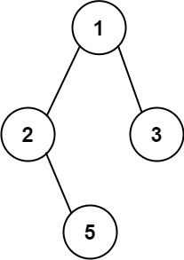

# 257. 二叉树的所有路径 - LeetCode Python/Java/C++/JS/C#/Go/Ruby 题解

> [**前往 coder.id 打造你的开发者个人IP →**](https://www.coder.id)

访问原文链接：[257. 二叉树的所有路径 - LeetCode Python/Java/C++/JS/C#/Go/Ruby 题解](https://www.coder.id/leetcode/zh/solutions/257-binary-tree-paths)，体验更佳！

力扣链接：[257. 二叉树的所有路径](https://leetcode.cn/problems/binary-tree-paths), 难度等级：**简单**。

## LeetCode “257. 二叉树的所有路径”问题描述

给你一个二叉树的根节点 `root`。

按 **任意顺序** ，返回所有 **从根节点到叶子节点** 的路径。

**叶子节点** 是指没有子节点的节点。

### [示例 1]



**输入**: `root = [1,2,3,null,5]`

**输出**: `["1->2->5","1->3"]`

### [示例 2]

**输入**: `root = [1]`

**输出**: `["1"]`

### [约束]

- 树中节点的数目在范围 `[1, 100]` 内
- `-100 <= Node.val <= 100`

## 思路 1


## 复杂度

- 时间复杂度: `O(n)`.
- 空间复杂度: `O(n)`.

## Python

```python
# Definition for a binary tree node.
# class TreeNode:
#     def __init__(self, val=0, left=None, right=None):
#         self.val = val
#         self.left = left
#         self.right = right

class Solution:
    def binaryTreePaths(self, root: TreeNode | None) -> list[str]:
        self.paths = []
        self.traverse(root, [])
        return self.paths
    
    def traverse(self, node, path):
        if node is None:
            return

        path = path + [node.val]

        if is_leaf(node):
            self.paths.append('->'.join([str(item) for item in path]))
            return

        self.traverse(node.left, path)
        self.traverse(node.right, path)


def is_leaf(node):
    return node.left is None and node.right is None
```

## Other languages

```java
// Welcome to create a PR to complete the code of this language, thanks!
```

## 思路 2


## 复杂度

- 时间复杂度: `O(n)`.
- 空间复杂度: `O(n)`.

## Python

```python
# Definition for a binary tree node.
# class TreeNode:
#     def __init__(self, val=0, left=None, right=None):
#         self.val = val
#         self.left = left
#         self.right = right

class Solution:
    def binaryTreePaths(self, root: TreeNode | None) -> list[str]:
        self.paths = []
        self.path = [root.val]
        self.traverse(root)
        return self.paths
    
    def traverse(self, node):
        if is_leaf(node):
            self.paths.append('->'.join([str(item) for item in self.path]))
            return

        if node.left:
            self.path.append(node.left.val)
            self.traverse(node.left)
            self.path.pop()

        if node.right:
            self.path.append(node.right.val)
            self.traverse(node.right)
            self.path.pop()


def is_leaf(node):
    return node.left is None and node.right is None
```

## Other languages

```java
// Welcome to create a PR to complete the code of this language, thanks!
```

> 🚀 **打造你的开发者个人IP**
>
> 掌握算法是成功的基石，而全方位展示你的才华则是获得垂青的关键。
>
> 我的另一个项目 [**coder.id**](https://www.coder.id) —— 专为程序员打造的“全能型”个人品牌展示平台。
>
> **三位一体（All-In-One）的职场利器：**
> - 📄 **简历 + 作品集 + 博客：** 将你的 GitHub 项目、技术心得与职场经历完美融合。
> - 🌐 **永久免费自定义域名：** 支持绑定你自己的独立域名，且该功能永久免费。
> - ✨ **顶级行业子域名：** 提供 `name.coder.id`，极具职业含金量的专属域名。

>
> [**立即前往 coder.id 打造你的个人品牌 →**](https://www.coder.id)

---

访问原文链接：[257. 二叉树的所有路径 - LeetCode Python/Java/C++/JS/C#/Go/Ruby 题解](https://www.coder.id/leetcode/zh/solutions/257-binary-tree-paths)，体验更佳！

GitHub 仓库: [leetcode-python-java](https://github.com/leetcode-python-java/leetcode-python-java).

