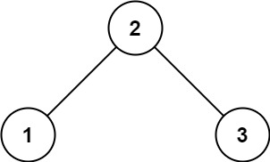
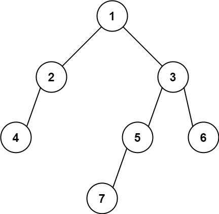

# 513. 找树左下角的值 - LeetCode Python/Java/C++/JS/C#/Go/Ruby 题解

> [**前往 coder.id 打造你的开发者个人IP →**](https://www.coder.id)

访问原文链接：[513. 找树左下角的值 - LeetCode Python/Java/C++/JS/C#/Go/Ruby 题解](https://www.coder.id/leetcode/zh/solutions/513-find-bottom-left-tree-value)，体验更佳！

力扣链接：[513. 找树左下角的值](https://leetcode.cn/problems/find-bottom-left-tree-value), 难度等级：**中等**。

## LeetCode “513. 找树左下角的值”问题描述

给定一个二叉树的 **根节点** `root`。

请找出该二叉树的 **最底层 最左边** 节点的值。

### [示例 1]



**输入**: `root = [2,1,3]`

**输出**: `1`

**解释**: `最后一行是 [1, 3]，因此最左边的值是 1。`

### [示例 2]



**输入**: `root = [1,2,3,4,null,5,6,null,null,7]`

**输出**: `7`

**解释**: `最后一层只有节点 7。`

### [约束]

- 二叉树的节点个数的范围是 `[1, 10^4]`
- `-2^31 <= Node.val <= 2^31 - 1`

## 思路


## 复杂度

- 时间复杂度: `O(n)`.
- 空间复杂度: `O(n)`.

## Python

```python
# Definition for a binary tree node.
# class TreeNode:
#     def __init__(self, val=0, left=None, right=None):
#         self.val = val
#         self.left = left
#         self.right = right

class Solution:
    def findBottomLeftValue(self, root: TreeNode | None) -> int:
        queue = deque([root]) # Breadth First Search need a queue
        result = None

        while queue:
            for i in range(len(queue)): # Key. Go through this level's all nodes.
                node = queue.popleft()
                if i == 0:
                    result = node.val # The first of this level is the leftest node.
                if node.left:
                    queue.append(node.left)
                if node.right:
                    queue.append(node.right)

        return result
```

## Other languages

```java
// Welcome to create a PR to complete the code of this language, thanks!
```

> 🚀 **打造你的开发者个人IP**
>
> 掌握算法是成功的基石，而全方位展示你的才华则是获得垂青的关键。
>
> 我的另一个项目 [**coder.id**](https://www.coder.id) —— 专为程序员打造的“全能型”个人品牌展示平台。
>
> **三位一体（All-In-One）的职场利器：**
> - 📄 **简历 + 作品集 + 博客：** 将你的 GitHub 项目、技术心得与职场经历完美融合。
> - 🌐 **永久免费自定义域名：** 支持绑定你自己的独立域名，且该功能永久免费。
> - ✨ **顶级行业子域名：** 提供 `name.coder.id`，极具职业含金量的专属域名。

>
> [**立即前往 coder.id 打造你的个人品牌 →**](https://www.coder.id)

---

访问原文链接：[513. 找树左下角的值 - LeetCode Python/Java/C++/JS/C#/Go/Ruby 题解](https://www.coder.id/leetcode/zh/solutions/513-find-bottom-left-tree-value)，体验更佳！

GitHub 仓库: [leetcode-python-java](https://github.com/leetcode-python-java/leetcode-python-java).

