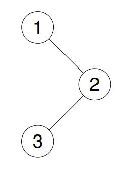
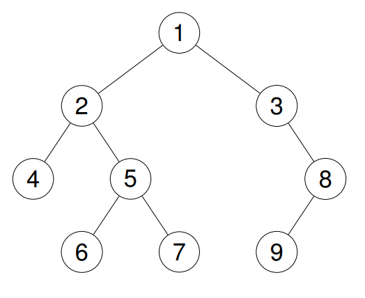

# 94. 二叉树的中序遍历 - LeetCode Python/Java/C++/JS/C#/Go/Ruby 题解

> [**前往 coder.id 打造你的开发者个人IP →**](https://www.coder.id)

访问原文链接：[94. 二叉树的中序遍历 - LeetCode Python/Java/C++/JS/C#/Go/Ruby 题解](https://www.coder.id/leetcode/zh/solutions/94-binary-tree-inorder-traversal)，体验更佳！

力扣链接：[94. 二叉树的中序遍历](https://leetcode.cn/problems/binary-tree-inorder-traversal), 难度等级：**简单**。

## LeetCode “94. 二叉树的中序遍历”问题描述

给定一个二叉树的根节点 `root` ，返回 *它的 **中序** 遍历* 。

**进阶:** 递归算法很简单，你可以通过迭代算法完成吗？

### [示例 1]



**输入**: `root = [1,null,2,3]`

**输出**: `[1,3,2]`

### [示例 2]



**输入**: `root = [1,2,3,4,5,null,8,null,null,6,7,9]`

**输出**: `[4,2,6,5,7,1,3,9,8]`

### [示例 3]

**输入**: `root = []`

**输出**: `[]`

### [示例 4]

**输入**: `root = [1]`

**输出**: `[1]`

### [约束]

- 树中节点数目在范围 `[0, 100]` 内
- `-100 <= Node.val <= 100`

## 思路 1


## 复杂度

- 时间复杂度: `O(n)`.
- 空间复杂度: `O(n)`.

## Python

```python
# Definition for a binary tree node.
# class TreeNode:
#     def __init__(self, val=0, left=None, right=None):
#         self.val = val
#         self.left = left
#         self.right = right

class Solution:
    def inorderTraversal(self, root: TreeNode | None) -> list[int]:
        self.result = []
        self.traverse(root)
        return self.result
    
    def traverse(self, node):
        if not node:
            return

        self.traverse(node.left)
        self.result.append(node.val)
        self.traverse(node.right)

```

## Other languages

```java
// Welcome to create a PR to complete the code of this language, thanks!
```

## 思路 2


## 复杂度

- 时间复杂度: `O(n)`.
- 空间复杂度: `O(n)`.

## Python

```python
# Definition for a binary tree node.
# class TreeNode:
#     def __init__(self, val=0, left=None, right=None):
#         self.val = val
#         self.left = left
#         self.right = right

class Solution:
    def inorderTraversal(self, root: TreeNode | None) -> list[int]:
        if root is None:
            return []

        stack = [(root, False)] # key 1
        result = []

        while stack:
            node, visited = stack.pop()

            if visited: # key 2
                result.append(node.val)
                continue
            
            if node.right:
                stack.append((node.right, False))
            
            stack.append((node, True)) # key 3

            if node.left:
                stack.append((node.left, False))

        return result
```

## Other languages

```java
// Welcome to create a PR to complete the code of this language, thanks!
```

> 🚀 **打造你的开发者个人IP**
>
> 掌握算法是成功的基石，而全方位展示你的才华则是获得垂青的关键。
>
> 我的另一个项目 [**coder.id**](https://www.coder.id) —— 专为程序员打造的“全能型”个人品牌展示平台。
>
> **三位一体（All-In-One）的职场利器：**
> - 📄 **简历 + 作品集 + 博客：** 将你的 GitHub 项目、技术心得与职场经历完美融合。
> - 🌐 **永久免费自定义域名：** 支持绑定你自己的独立域名，且该功能永久免费。
> - ✨ **顶级行业子域名：** 提供 `name.coder.id`，极具职业含金量的专属域名。

>
> [**立即前往 coder.id 打造你的个人品牌 →**](https://www.coder.id)

---

访问原文链接：[94. 二叉树的中序遍历 - LeetCode Python/Java/C++/JS/C#/Go/Ruby 题解](https://www.coder.id/leetcode/zh/solutions/94-binary-tree-inorder-traversal)，体验更佳！

GitHub 仓库: [leetcode-python-java](https://github.com/leetcode-python-java/leetcode-python-java).

