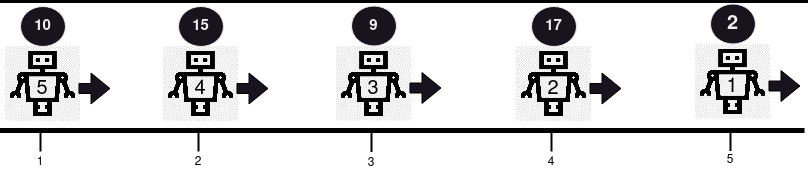
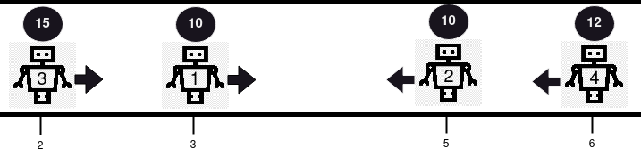
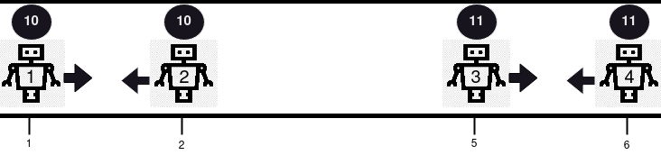

# 2751. 机器人碰撞 - LeetCode Python/Java/C++/JS/C#/Go/Ruby 题解

> [**前往 coder.id 打造你的开发者个人IP →**](https://www.coder.id)

访问原文链接：[2751. 机器人碰撞 - LeetCode Python/Java/C++/JS/C#/Go/Ruby 题解](https://www.coder.id/leetcode/zh/solutions/2751-robot-collisions)，体验更佳！

力扣链接：[2751. 机器人碰撞](https://leetcode.cn/problems/robot-collisions), 难度等级：**困难**。

## LeetCode “2751. 机器人碰撞”问题描述

现有 `n` 个机器人，编号从 **1** 开始，每个机器人包含在路线上的位置、健康度和移动方向。

给你下标从 **0** 开始的两个整数数组 `positions`、`healths` 和一个字符串 `directions`（`directions[i]` 为 **'L'** 表示**向左**或 **'R'** 表示**向右**）。 `positions` 中的所有整数 **互不相同** 。

所有机器人以 **相同速度** **同时** 沿给定方向在路线上移动。如果两个机器人移动到相同位置，则会发生 **碰撞** 。

如果两个机器人发生碰撞，则将 **健康度较低** 的机器人从路线中 **移除** ，并且另一个机器人的健康度 **减少 1** 。幸存下来的机器人将会继续沿着与之前 **相同** 的方向前进。如果两个机器人的健康度相同，则将二者都从路线中移除。

请你确定全部碰撞后幸存下的机器人的 **健康度** ，并按照原来机器人编号的顺序排列。即机器人 1 （如果幸存）的最终健康度，机器人 2 （如果幸存）的最终健康度等。 如果不存在幸存的机器人，则返回空数组。

在不再发生任何碰撞后，请你以数组形式，返回所有剩余机器人的健康度（按它们在输入中出现的顺序排列）。

**注意：**位置数组可能未排序。

### [示例 1]



**输入**: `positions = [5,4,3,2,1], healths = [2,17,9,15,10], directions = "RRRRR"`

**输出**: `[2,17,9,15,10]`

**解释**: 

<p>在这个例子中没有发生任何碰撞，因为所有机器人向同一方向移动。所以，从第一个机器人开始按顺序返回机器人的健康度，[2, 17, 9, 15, 10]。</p>


### [示例 2]



**输入**: `positions = [3,5,2,6], healths = [10,10,15,12], directions = "RLRL"`

**输出**: `[14]`

**解释**: 

<p>本例中发生 2 次碰撞。首先，机器人 1 和机器人 2 将会发生碰撞，因为二者健康度相同，二者都将被从路线中移除。接下来，机器人 3 和机器人 4 将发生碰撞，由于机器人 4 的健康度更小，则它会被移除，而机器人 3 的健康度变为 15 - 1 = 14 。仅剩机器人 3 ，所以返回 [14] 。</p>


### [示例 3]



**输入**: `positions = [1,2,5,6], healths = [10,10,11,11], directions = "RLRL"`

**输出**: `[]`

**解释**: 

<p>机器人 1 和机器人 2 将会发生碰撞，因为二者健康度相同，二者都将被从路线中移除。机器人 3 和 4 将会发生碰撞，因为二者健康度相同，二者都将被从路线中移除。所以返回空数组 [] 。</p>


### [约束]

- `1 <= positions.length == healths.length == directions.length == n <= 10^5`
- `1 <= positions[i], healths[i] <= 10^9`
- `directions[i] == 'L'` 或 `directions[i] == 'R'`
- `positions` 中的所有值互不相同

### [Hints]

<details>
  <summary>提示 1</summary>
  Process the robots in the order of their positions to ensure that we process the collisions correctly.

  
</details>

<details>
  <summary>提示 2</summary>
  To optimize the solution, use a stack to keep track of the surviving robots as we iterate through the positions.

  
</details>

<details>
  <summary>提示 3</summary>
  Instead of simulating each collision, check the current robot against the top of the stack (if it exists) to determine if a collision occurs.

  
</details>

## 思路

问题涉及到在直线上移动的机器人相遇时发生碰撞。

因为只有当向右移动的机器人遇到向左移动的机器人时才会发生碰撞，这自然让人想到使用栈（Stack）来模拟。

然而，由于输入的起始位置是未排序的，我们必须首先按位置对机器人进行排序，以便从左到右模拟这个过程。

为了按原始顺序返回最终的健康度，我们需要在排序前记录机器人的原始索引。

## 步骤

1. **打包并排序：** 创建一个包含 `(position, health, direction, original_index)` 的机器人对象或元组列表。主要按 `position` 对该列表进行排序。
2. **栈模拟：** 初始化一个空栈。遍历排序后的机器人：
   - 如果机器人向右移动 ('R')，将其推入栈中。
   - 如果机器人向左移动 ('L')，检查是否与当前栈中的任何 'R' 机器人发生碰撞。
3. **处理碰撞：** 当栈不为空，栈顶是一个 'R' 机器人，且当前 'L' 机器人的健康度 > 0 时：
   - 如果栈顶 'R' 机器人的健康度**较大**：'L' 机器人被销毁（健康度变为 0），栈顶 'R' 机器人的健康度减少 1。
   - 如果栈顶 'R' 机器人的健康度**较小**：栈顶 'R' 机器人被销毁（从栈中弹出），'L' 机器人的健康度减少 1。继续检查栈中的下一个机器人。
   - 如果它们的健康度**相同**：两者都被销毁。从栈中弹出 'R' 机器人，'L' 机器人的健康度变为 0。
4. **幸存的向左机器人：** 如果 'L' 机器人在所有碰撞后幸存下来（其健康度 > 0），将其推入栈中。
5. **恢复原始顺序：** 处理完所有机器人后，按其 `original_index` 对栈中剩余的机器人进行排序。
6. **提取结果：** 遍历重新排序的栈，并将其健康度提取到最终的答案数组中。

## 复杂度

> - **时间复杂度：** 最初对机器人进行排序需要 `O(N log N)` 的时间。模拟过程处理每个机器人，最多将其推入和弹出栈一次，这需要 `O(N)` 的时间。最后，将幸存的机器人恢复到其原始顺序需要 `O(N log N)` 的时间。因此，总体时间复杂度由排序决定，为 `O(N log N)`。
- **空间复杂度：** 我们创建了一个结构体数组/列表来存储打包的机器人数据，这需要 `O(N)` 的空间。在最坏的情况下，栈最多也可以容纳 `N` 个机器人，占用 `O(N)` 的空间。因此，总体空间复杂度为 `O(N)`。

- 时间复杂度: `O(N log N)`.
- 空间复杂度: `O(N)`.

## Python

```python
class Solution:
    def survivedRobotsHealths(self, positions: List[int], healths: List[int], directions: str) -> List[int]:
        n = len(positions)
        # Store original indices to restore order later
        # We pair (position, health, direction, original_index)
        robots = []
        for i in range(n):
            robots.append([positions[i], healths[i], directions[i], i])
            
        # Sort robots by their positions from left to right
        robots.sort(key=lambda x: x[0])
        
        stack = [] # This will store the surviving robots
        
        for robot in robots:
            pos, health, dir, idx = robot
            
            if dir == 'R':
                # Right-moving robots are just added to the stack
                # They might collide with future Left-moving robots
                stack.append(robot)
            else:
                # Left-moving robot, check for collisions
                while stack and stack[-1][2] == 'R' and health > 0:
                    top_health = stack[-1][1]
                    
                    if top_health > health:
                        # Top robot survives, health decreases by 1
                        stack[-1][1] -= 1
                        health = 0 # Current robot is destroyed
                    elif top_health < health:
                        # Current robot survives, health decreases by 1
                        stack.pop() # Top robot is destroyed
                        health -= 1
                    else:
                        # Both have the same health, both are destroyed
                        stack.pop()
                        health = 0
                
                # If the Left-moving robot survived all collisions, add it to the stack
                if health > 0:
                    robot[1] = health # Update the health in the robot list
                    stack.append(robot)
                    
        # Sort the surviving robots by their original indices
        stack.sort(key=lambda x: x[3])
        
        # Return only the healths
        return [robot[1] for robot in stack]
```

## Ruby

```ruby
# @param {Integer[]} positions
# @param {Integer[]} healths
# @param {String} directions
# @return {Integer[]}
def survived_robots_healths(positions, healths, directions)
  n = positions.length
  
  # Bundle the attributes together with the original index
  robots = (0...n).map do |i|
    { pos: positions[i], health: healths[i], dir: directions[i], idx: i }
  end
  
  # Sort robots from left to right based on position
  robots.sort_by! { |r| r[:pos] }
  
  stack = []
  
  robots.each do |robot|
    if robot[:dir] == 'R'
      # Push right-moving robots to the stack to wait for potential collisions
      stack.push(robot)
    else
      # Handle collisions for a left-moving robot
      while !stack.empty? && stack.last[:dir] == 'R' && robot[:health] > 0
        top_robot = stack.last
        
        if top_robot[:health] > robot[:health]
          # The right-moving robot in stack survives
          top_robot[:health] -= 1
          robot[:health] = 0
        elsif top_robot[:health] < robot[:health]
          # The current left-moving robot survives
          stack.pop
          robot[:health] -= 1
        else
          # Both robots have the same health, both are destroyed
          stack.pop
          robot[:health] = 0
        end
      end
      
      # If the left-moving robot survived, it can continue moving left safely
      stack.push(robot) if robot[:health] > 0
    end
  end
  
  # Restore the original order of the surviving robots
  stack.sort_by! { |r| r[:idx] }
  
  # Extract and return the final healths
  stack.map { |r| r[:health] }
end
```

## JavaScript

```javascript
/**
 * @param {number[]} positions
 * @param {number[]} healths
 * @param {string} directions
 * @return {number[]}
 */
var survivedRobotsHealths = function(positions, healths, directions) {
    const n = positions.length;
    // Bundle the data with the original index
    const robots = [];
    for (let i = 0; i < n; i++) {
        robots.push({
            pos: positions[i],
            health: healths[i],
            dir: directions[i],
            idx: i
        });
    }
    
    // Sort robots by position (ascending order)
    robots.sort((a, b) => a.pos - b.pos);
    
    const stack = [];
    
    for (const robot of robots) {
        if (robot.dir === 'R') {
            // Right-moving robots wait in the stack
            stack.push(robot);
        } else {
            // Left-moving robot, process collisions
            while (stack.length > 0 && stack[stack.length - 1].dir === 'R' && robot.health > 0) {
                const topRobot = stack[stack.length - 1];
                
                if (topRobot.health > robot.health) {
                    // Right-moving robot wins
                    topRobot.health -= 1;
                    robot.health = 0;
                } else if (topRobot.health < robot.health) {
                    // Left-moving robot wins
                    stack.pop();
                    robot.health -= 1;
                } else {
                    // Draw: both destroyed
                    stack.pop();
                    robot.health = 0;
                }
            }
            
            // If the left-moving robot survives, push it to stack
            if (robot.health > 0) {
                stack.push(robot);
            }
        }
    }
    
    // Restore the original order based on idx
    stack.sort((a, b) => a.idx - b.idx);
    
    // Map to just their healths
    return stack.map(r => r.health);
};
```

## Java

```java
class Solution {
    // Helper class to encapsulate robot details
    static class Robot {
        int pos;
        int health;
        char dir;
        int idx;
        
        Robot(int pos, int health, char dir, int idx) {
            this.pos = pos;
            this.health = health;
            this.dir = dir;
            this.idx = idx;
        }
    }
    
    public List<Integer> survivedRobotsHealths(int[] positions, int[] healths, String directions) {
        int n = positions.length;
        Robot[] robots = new Robot[n];
        
        // Bundle attributes
        for (int i = 0; i < n; i++) {
            robots[i] = new Robot(positions[i], healths[i], directions.charAt(i), i);
        }
        
        // Sort robots by position
        Arrays.sort(robots, (a, b) -> Integer.compare(a.pos, b.pos));
        
        // Use a stack to simulate collisions
        List<Robot> stack = new ArrayList<>();
        
        for (Robot robot : robots) {
            if (robot.dir == 'R') {
                stack.add(robot);
            } else {
                // Collide with right-moving robots
                while (!stack.isEmpty() && stack.get(stack.size() - 1).dir == 'R' && robot.health > 0) {
                    Robot topRobot = stack.get(stack.size() - 1);
                    
                    if (topRobot.health > robot.health) {
                        topRobot.health -= 1;
                        robot.health = 0; // Current robot is destroyed
                    } else if (topRobot.health < robot.health) {
                        stack.remove(stack.size() - 1); // Top robot is destroyed
                        robot.health -= 1;
                    } else {
                        // Both are destroyed
                        stack.remove(stack.size() - 1);
                        robot.health = 0;
                    }
                }
                
                // If current left-moving robot survives
                if (robot.health > 0) {
                    stack.add(robot);
                }
            }
        }
        
        // Sort surviving robots back to their original input order
        stack.sort((a, b) -> Integer.compare(a.idx, b.idx));
        
        // Extract the health values
        List<Integer> result = new ArrayList<>();
        for (Robot robot : stack) {
            result.add(robot.health);
        }
        
        return result;
    }
}
```

## Cpp

```cpp
#include <vector>
#include <string>
#include <numeric>
#include <algorithm>

using namespace std;

class Solution {
    struct Robot {
        int pos;
        int health;
        char dir;
        int idx;
    };
    
public:
    vector<int> survivedRobotsHealths(vector<int>& positions, vector<int>& healths, string directions) {
        int n = positions.size();
        vector<Robot> robots;
        robots.reserve(n);
        
        // Populate the robots vector
        for (int i = 0; i < n; ++i) {
            robots.push_back({positions[i], healths[i], directions[i], i});
        }
        
        // Sort based on position
        sort(robots.begin(), robots.end(), [](const Robot& a, const Robot& b) {
            return a.pos < b.pos;
        });
        
        vector<Robot> stack;
        
        for (auto& robot : robots) {
            if (robot.dir == 'R') {
                stack.push_back(robot);
            } else {
                // Resolve collisions for left-moving robot
                while (!stack.empty() && stack.back().dir == 'R' && robot.health > 0) {
                    if (stack.back().health > robot.health) {
                        stack.back().health -= 1;
                        robot.health = 0;
                    } else if (stack.back().health < robot.health) {
                        stack.pop_back();
                        robot.health -= 1;
                    } else {
                        stack.pop_back();
                        robot.health = 0;
                    }
                }
                
                if (robot.health > 0) {
                    stack.push_back(robot);
                }
            }
        }
        
        // Restore original order
        sort(stack.begin(), stack.end(), [](const Robot& a, const Robot& b) {
            return a.idx < b.idx;
        });
        
        // Construct the result
        vector<int> result;
        result.reserve(stack.size());
        for (const auto& robot : stack) {
            result.push_back(robot.health);
        }
        
        return result;
    }
};
```

## Csharp

```csharp
using System;
using System.Collections.Generic;

public class Solution {
    // Structure to hold robot details
    class Robot {
        public int pos;
        public int health;
        public char dir;
        public int idx;
        
        public Robot(int p, int h, char d, int i) {
            pos = p;
            health = h;
            dir = d;
            idx = i;
        }
    }
    
    public IList<int> SurvivedRobotsHealths(int[] positions, int[] healths, string directions) {
        int n = positions.Length;
        Robot[] robots = new Robot[n];
        
        for (int i = 0; i < n; i++) {
            robots[i] = new Robot(positions[i], healths[i], directions[i], i);
        }
        
        // Sort by position
        Array.Sort(robots, (a, b) => a.pos.CompareTo(b.pos));
        
        List<Robot> stack = new List<Robot>();
        
        foreach (var robot in robots) {
            if (robot.dir == 'R') {
                stack.Add(robot);
            } else {
                // Process collisions
                while (stack.Count > 0 && stack[^1].dir == 'R' && robot.health > 0) {
                    Robot topRobot = stack[^1];
                    
                    if (topRobot.health > robot.health) {
                        topRobot.health--;
                        robot.health = 0;
                    } else if (topRobot.health < robot.health) {
                        stack.RemoveAt(stack.Count - 1);
                        robot.health--;
                    } else {
                        stack.RemoveAt(stack.Count - 1);
                        robot.health = 0;
                    }
                }
                
                if (robot.health > 0) {
                    stack.Add(robot);
                }
            }
        }
        
        // Sort back to original indices
        stack.Sort((a, b) => a.idx.CompareTo(b.idx));
        
        List<int> result = new List<int>();
        foreach (var robot in stack) {
            result.Add(robot.health);
        }
        
        return result;
    }
}
```

## Go

```go
package main

import (
	"sort"
)

type Robot struct {
	pos    int
	health int
	dir    byte
	idx    int
}

func survivedRobotsHealths(positions []int, healths []int, directions string) []int {
	n := len(positions)
	robots := make([]Robot, n)
	
	for i := 0; i < n; i++ {
		robots[i] = Robot{
			pos:    positions[i],
			health: healths[i],
			dir:    directions[i],
			idx:    i,
		}
	}
	
	// Sort robots by position
	sort.Slice(robots, func(i, j int) bool {
		return robots[i].pos < robots[j].pos
	})
	
	var stack []Robot
	
	for _, robot := range robots {
		if robot.dir == 'R' {
			stack = append(stack, robot)
		} else {
			// Process left-moving robot
			for len(stack) > 0 && stack[len(stack)-1].dir == 'R' && robot.health > 0 {
				top := stack[len(stack)-1]
				
				if top.health > robot.health {
					stack[len(stack)-1].health--
					robot.health = 0
				} else if top.health < robot.health {
					stack = stack[:len(stack)-1]
					robot.health--
				} else {
					stack = stack[:len(stack)-1]
					robot.health = 0
				}
			}
			
			if robot.health > 0 {
				stack = append(stack, robot)
			}
		}
	}
	
	// Sort remaining robots by their original index
	sort.Slice(stack, func(i, j int) bool {
		return stack[i].idx < stack[j].idx
	})
	
	result := make([]int, len(stack))
	for i, robot := range stack {
		result[i] = robot.health
	}
	
	return result
}
```

## Rust

```rust
impl Solution {
    pub fn survived_robots_healths(positions: Vec<i32>, healths: Vec<i32>, directions: String) -> Vec<i32> {
        let n = positions.len();
        let mut robots: Vec<(i32, i32, char, usize)> = Vec::with_capacity(n);
        let dirs: Vec<char> = directions.chars().collect();
        
        // Bundle attributes: (position, health, direction, original_index)
        for i in 0..n {
            robots.push((positions[i], healths[i], dirs[i], i));
        }
        
        // Sort by position
        robots.sort_by_key(|r| r.0);
        
        let mut stack: Vec<(i32, i32, char, usize)> = Vec::new();
        
        for mut robot in robots {
            if robot.2 == 'R' {
                stack.push(robot);
            } else {
                let mut survived = true;
                
                while let Some(top) = stack.last_mut() {
                    if top.2 != 'R' { break; }
                    
                    if top.1 > robot.1 {
                        top.1 -= 1;
                        survived = false;
                        break;
                    } else if top.1 < robot.1 {
                        stack.pop();
                        robot.1 -= 1;
                    } else {
                        stack.pop();
                        survived = false;
                        break;
                    }
                }
                
                if survived {
                    stack.push(robot);
                }
            }
        }
        
        // Restore original order
        stack.sort_by_key(|r| r.3);
        
        stack.into_iter().map(|r| r.1).collect()
    }
}
```

## Kotlin

```kotlin
class Solution {
    class Robot(var pos: Int, var health: Int, var dir: Char, var idx: Int)

    fun survivedRobotsHealths(positions: IntArray, healths: IntArray, directions: String): List<Int> {
        val n = positions.size
        val robots = Array(n) { i ->
            Robot(positions[i], healths[i], directions[i], i)
        }
        
        // Sort robots based on their position
        robots.sortBy { it.pos }
        
        val stack = mutableListOf<Robot>()
        
        for (robot in robots) {
            if (robot.dir == 'R') {
                stack.add(robot)
            } else {
                var isAlive = true
                while (stack.isNotEmpty() && stack.last().dir == 'R' && robot.health > 0) {
                    val topRobot = stack.last()
                    
                    if (topRobot.health > robot.health) {
                        topRobot.health -= 1
                        robot.health = 0
                        isAlive = false
                    } else if (topRobot.health < robot.health) {
                        stack.removeAt(stack.size - 1)
                        robot.health -= 1
                    } else {
                        stack.removeAt(stack.size - 1)
                        robot.health = 0
                        isAlive = false
                    }
                }
                
                if (isAlive && robot.health > 0) {
                    stack.add(robot)
                }
            }
        }
        
        // Sort by the original indices
        stack.sortBy { it.idx }
        
        return stack.map { it.health }
    }
}
```

## Swift

```swift
class Solution {
    struct Robot {
        var pos: Int
        var health: Int
        var dir: Character
        var idx: Int
    }
    
    func survivedRobotsHealths(_ positions: [Int], _ healths: [Int], _ directions: String) -> [Int] {
        let n = positions.count
        var robots: [Robot] = []
        let dirArray = Array(directions)
        
        // Bundle attributes
        for i in 0..<n {
            robots.append(Robot(pos: positions[i], health: healths[i], dir: dirArray[i], idx: i))
        }
        
        // Sort by position
        robots.sort { $0.pos < $1.pos }
        
        var stack: [Robot] = []
        
        for i in 0..<robots.count {
            var robot = robots[i]
            
            if robot.dir == "R" {
                stack.append(robot)
            } else {
                while !stack.isEmpty && stack.last!.dir == "R" && robot.health > 0 {
                    let topIdx = stack.count - 1
                    
                    if stack[topIdx].health > robot.health {
                        stack[topIdx].health -= 1
                        robot.health = 0
                    } else if stack[topIdx].health < robot.health {
                        stack.removeLast()
                        robot.health -= 1
                    } else {
                        stack.removeLast()
                        robot.health = 0
                    }
                }
                
                if robot.health > 0 {
                    stack.append(robot)
                }
            }
        }
        
        // Sort back to original order
        stack.sort { $0.idx < $1.idx }
        
        return stack.map { $0.health }
    }
}
```

## Other languages

```java
// Welcome to create a PR to complete the code of this language, thanks!
```

> 🚀 **打造你的开发者个人IP**
>
> 掌握算法是成功的基石，而全方位展示你的才华则是获得垂青的关键。
>
> 我的另一个项目 [**coder.id**](https://www.coder.id) —— 专为程序员打造的“全能型”个人品牌展示平台。
>
> **三位一体（All-In-One）的职场利器：**
> - 📄 **简历 + 作品集 + 博客：** 将你的 GitHub 项目、技术心得与职场经历完美融合。
> - 🌐 **永久免费自定义域名：** 支持绑定你自己的独立域名，且该功能永久免费。
> - ✨ **顶级行业子域名：** 提供 `name.coder.id`，极具职业含金量的专属域名。

>
> [**立即前往 coder.id 打造你的个人品牌 →**](https://www.coder.id)

---

访问原文链接：[2751. 机器人碰撞 - LeetCode Python/Java/C++/JS/C#/Go/Ruby 题解](https://www.coder.id/leetcode/zh/solutions/2751-robot-collisions)，体验更佳！

GitHub 仓库: [leetcode-python-java](https://github.com/leetcode-python-java/leetcode-python-java).

